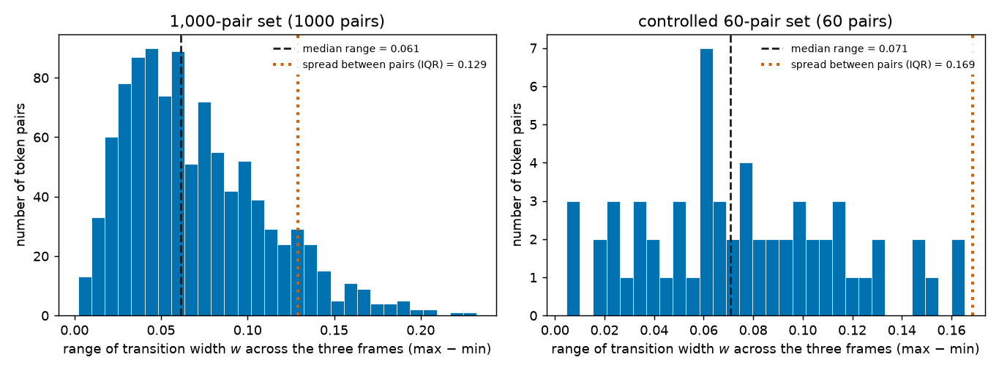
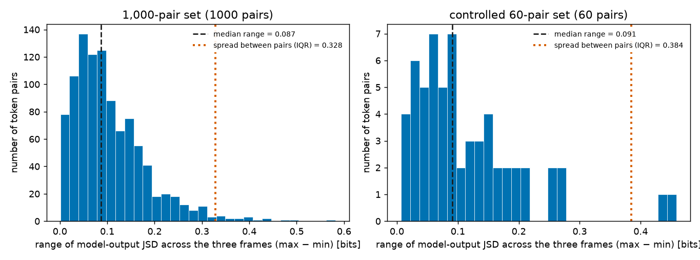
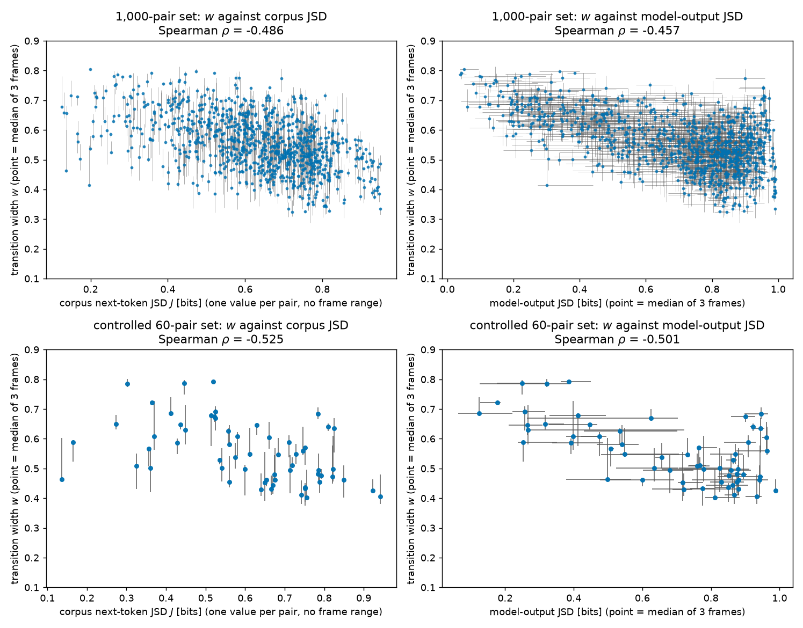

# How much do the measurements vary across the three sentence frames?

## Summary

**Research question.** The main report (`REPORT.md`) found that, in a trained language model, pairs of
tokens whose next-token statistics differ more have narrower transitions when we interpolate between
them. Every pair was measured in three fixed sentence frames and only the median of the three values
was reported. This report asks: **how much do the per-pair measurements differ from one frame to
another, and is that difference large enough to weaken trust in the result?**

**Why it matters.** If one pair's measurement moved as much between frames as it differs from other
pairs, the reported association could depend on which three frames happened to be chosen. A result
about how a model separates tokens is only useful for understanding the model if it does not hinge on
such a choice.

**What we found.**

- **The frames do matter for individual pairs.** A pair's transition width typically changes by 0.061
  between its lowest and highest frame (1,000-pair set; 0.071 on the 60-pair set). That is a little
  under half of the typical difference between pairs (0.129 and 0.169). Figure 1.
- **The model-output JSD varies less in relative terms.** Its typical frame range is 0.087 bits (0.091
  on the 60-pair set), about a quarter of the typical difference between pairs. Figure 2.
- **The association itself appears in every frame.** Computed from one frame alone, the rank
  correlation between corpus JSD and transition width is −0.499, −0.417 and −0.483 on the 1,000-pair
  set and −0.486, −0.411 and −0.504 on the 60-pair set. Using each pair's lowest or its highest frame
  value gives −0.457 to −0.507. Tables 2 and 3, Figure 3.
- **Conclusion.** Frame variation is large enough that a single pair's width should be read as
  approximate, to within roughly ±0.03 to ±0.06. It is too small to create or remove the association
  across pairs. This holds for the three frames tested, which are similar to one another; it is not a
  statement about arbitrary contexts.

No new model runs were needed. Every number comes from per-frame values that the original experiment
already stored.

## Methods

### Data and model

**Model.** EleutherAI Pythia-1.4B (deduped), a 1.4-billion-parameter, 24-block transformer language
model, at its final training checkpoint (step 143,000). A *token* is one unit of the model's
vocabulary, usually a word or word piece.

**Sentence frames.** A *sentence frame* is a fixed prefix that a token is appended to. The three frames
are `The thing was`, `They said it was` and `I thought it was`. For a token pair $(u, v)$ and a frame,
the experiment builds two prompts that differ only in their last token: the frame followed by $u$, and
the frame followed by $v$.

**Token pairs.** Two sets from the main report are used, both unchanged:

- the **1,000-pair set**, built from 123 tokens, in which a token can appear in several pairs;
- the **controlled 60-pair set**, in which no token is used twice.

That gives 3,000 and 180 per-frame measurements. All of them passed the validity checks of the main
report, so no pair or frame is missing here.

**Hook point.** The *residual state* is the vector a transformer carries forward at each token
position. All measurements read and replace the residual state at the final token position directly
after block 0, the first of the 24 blocks.

**Code and files.** `experiments/frame_variation.py` reads `results/assay_large_step143000.json` and
`results/assay_step143000_t256.json` and writes `results/frame_variation.json`.

### The three quantities

To ask whether a result survives a change of frame, we first need the quantities the result is built
from, measured one frame at a time.

**Transition width `w`** — answers "how abruptly does the model's output switch from behaving as if it
read $u$ to behaving as if it read $v$?" In one frame, take the two residual states $x_u$ and $x_v$,
and build 50 intermediate states $x(t)$ for evenly spaced $t$ from 0 to 1 (by spherical interpolation,
which keeps the vector length realistic). Insert each $x(t)$ into the model, run the remaining blocks,
and read the output scores over the vocabulary, called *logits*, $z(t)$. The output-distance score
says how far the output has moved from $u$'s output towards $v$'s:

```math
d(t) = \frac{\lVert z(t) - z_u \rVert_2}{\lVert z(t) - z_u \rVert_2 + \lVert z(t) - z_v \rVert_2}
```

It is 0 at $t = 0$ and 1 at $t = 1$. The transition width is the fraction of the path over which $d$
climbs from 0.1 to 0.9:

```math
w = t(d = 0.9) - t(d = 0.1)
```

A smaller $w$ means a more abrupt switch. An output that moved in exact proportion to $t$ would give
$w = 0.8$. One $w$ is measured per pair per frame; Figures 1 and 3 use it.

**Corpus next-token JSD `J`** — the predictor of the main result. It answers "how differently are these
two tokens continued in real text?" From counts in a sample of the model's training text we estimate,
for each token, the distribution $P_u$ of the token that follows it. The Jensen-Shannon divergence
(JSD) is a symmetric measure of how different two probability distributions are:

```math
J(u,v) = \tfrac12 D_{KL}(P_u \Vert m) + \tfrac12 D_{KL}(P_v \Vert m), \qquad m = \tfrac12 (P_u + P_v)
```

where $D_{KL}$ is the Kullback-Leibler divergence in base 2. $J$ runs from 0 bits (identical
continuations) to 1 bit (no continuation in common). **$J$ is computed from text counts with no
sentence frame involved, so it is a single number per pair and its range across frames is zero by
construction.** Figure 3 uses it as an x-axis.

**Model-output JSD** — the only JSD in this project that is measured per frame, and therefore the one
whose frame range can be shown. It answers "how differently does the model itself continue the two
tokens in this particular frame?" In frame $c$ it is the JSD between the model's two predicted
next-token distributions, each obtained by applying the softmax function to the logits (restricted to
the 50,060 token IDs that occur as followers in the corpus sample):

```math
JSD_{\mathrm{out}}^{(c)}(u,v) = JSD\big(\mathrm{softmax}(z_u^{(c)}),\ \mathrm{softmax}(z_v^{(c)})\big)
```

Higher means the model distinguishes the two tokens more in that frame. Figures 2 and 3 use it.

### Measuring frame variation

**Range across frames** — the quantity the histograms show. For a per-frame quantity $q$ (either $w$ or
the model-output JSD) and one token pair, the range is the largest of its three frame values minus the
smallest:

```math
R_q(u,v) = \max_{c \in \lbrace 1,2,3 \rbrace} q^{(c)}(u,v) - \min_{c \in \lbrace 1,2,3 \rbrace} q^{(c)}(u,v)
```

A range of 0 means the three frames agree exactly. The model's forward pass is deterministic, so a
non-zero range reflects the change of frame and not measurement noise.

**Reference scale: spread between pairs.** A range is only large or small relative to how much pairs
differ from each other, because the main result is a statement about differences between pairs. As the
reference we use the interquartile range (IQR) of the per-pair medians: the gap between the 25th and
75th percentile pair. Both histograms mark it.

**Rank correlation.** The main result is a Spearman rank correlation $\rho$ between $J$ and $w$ across
pairs: $-1$ means the pair order by $J$ is exactly reversed in $w$, 0 means no monotone relationship.
The main report computed it on each pair's median over frames. To test whether that depends on the
frame, we recompute it four more ways: from each single frame alone, and from each pair's smallest and
largest frame value. We also report the rank correlation of the same quantity between two frames, which
says how well the frames agree on the ordering of pairs (1 = identical ordering). These are direct
recomputations of the published number under different frame choices; no new significance test is
introduced.

**Baseline for comparison.** The main report's values and 95% confidence intervals are the baseline:
$\rho = -0.486$ with interval [−0.603, −0.353] on the 1,000-pair set (resampling tokens, because tokens
are reused across pairs) and $\rho = -0.525$ with interval [−0.701, −0.304] on the 60-pair set
(resampling pairs).

## Results

### 1. Transition width changes noticeably from frame to frame

To show how far a single pair's width moves when only the frame changes, Figure 1 plots the histogram
of the range of $w$ for both pair sets.



**Figure 1.** Range of transition width $w$ across the three sentence frames. x: range of $w$ (largest
minus smallest frame value, same units as $w$); y: number of token pairs. Left: 1,000-pair set; right:
controlled 60-pair set. The dashed vertical line is the median range; the dotted vertical line is the
spread between pairs (IQR of the per-pair median $w$).

The variation is moderate, not negligible. On the 1,000-pair set the median range is 0.061, half of
all pairs fall between 0.039 and 0.095, and the largest range is 0.232. The typical range is 47% of
the spread between pairs (0.129), and 9.4% of pairs have a range larger than that spread. The 60-pair
set looks the same: median 0.071, 42% of its between-pair spread (0.169), and no pair above it
(Table 1). The frames also differ slightly as a whole: the median width is 0.567, 0.542 and 0.557 in
the three frames, a shift much smaller than the per-pair ranges.

Table 1 collects the range statistics for both quantities, so the two histograms can be compared on
the same footing.

| Quantity, pair set | Median range | Middle 50% of ranges | Largest range | Spread between pairs (IQR) | Median range ÷ spread | Pairs with range > spread |
|---|---|---|---|---|---|---|
| $w$, 1,000 pairs | 0.061 | 0.039–0.095 | 0.232 | 0.129 | 0.47 | 9.4% |
| $w$, 60 pairs | 0.071 | 0.047–0.103 | 0.165 | 0.169 | 0.42 | 0% |
| Model-output JSD (bits), 1,000 pairs | 0.087 | 0.047–0.142 | 0.582 | 0.328 | 0.27 | 1.7% |
| Model-output JSD (bits), 60 pairs | 0.091 | 0.053–0.153 | 0.458 | 0.384 | 0.24 | 3.3% |

**Table 1.** Range across the three frames, per pair. Source: `results/frame_variation.json`.

### 2. Model-output JSD varies less, relative to how much pairs differ

The request asked for a histogram of the range of JSD. Corpus JSD has no frame range (Methods), so
Figure 2 shows the range of the model-output JSD, the JSD that is measured inside each frame.



**Figure 2.** Range of model-output JSD across the three sentence frames. x: range in bits (largest
minus smallest frame value); y: number of token pairs. Left: 1,000-pair set; right: controlled 60-pair
set. The dashed vertical line is the median range; the dotted vertical line is the spread between pairs
(IQR of the per-pair median model-output JSD).

The median range is 0.087 bits on the 1,000-pair set and 0.091 bits on the 60-pair set, about a
quarter of the spread between pairs (Table 1). A few pairs are strongly frame-dependent: for
` some`/` most` the model-output JSD is 0.34, 0.92 and 0.80 bits in the three frames. Such cases are
rare; 1.7% of the 1,000 pairs have a range above the between-pair spread.

### 3. The JSD-versus-width association is present in every frame

Figures 1 and 2 describe single pairs. Whether the frame variation threatens the result depends on
whether it changes the ordering of pairs. To make that visible, Figure 3 redraws the JSD-versus-width
scatter with each point's frame range drawn as error bars.



**Figure 3.** Transition width against JSD, with error bars showing the range across the three frames.
Each point is one token pair placed at its median over frames; each bar runs from the pair's smallest
to its largest frame value. y (all panels): transition width $w$. Left column: x = corpus next-token
JSD $J$ in bits, which has no frame range, so only vertical bars appear. Right column: x =
model-output JSD in bits, with horizontal bars for its range. Top row: 1,000-pair set; bottom row:
controlled 60-pair set. Panel titles give the Spearman $\rho$ of the plotted medians.

In the left column the vertical bars are short compared with the downward trend of the cloud from
low-JSD to high-JSD pairs, in both pair sets. The bars are long enough that neighbouring pairs often
overlap, so the ordering of two pairs with similar $J$ is not reliable. In the right column the
horizontal bars are longest for pairs with low and middle model-output JSD and short near 1 bit. This
is an observation; a plausible reason, not tested here, is that the JSD cannot exceed 1 bit, which
leaves little room to vary near the top.

Table 2 turns the visual impression into numbers by recomputing the main correlation under each frame
choice.

| How each pair's $w$ is chosen | 1,000-pair set | Controlled 60-pair set |
|---|---|---|
| Median of the three frames (main report) | −0.486 | −0.525 |
| Frame `The thing was` only | −0.499 | −0.486 |
| Frame `They said it was` only | −0.417 | −0.411 |
| Frame `I thought it was` only | −0.483 | −0.504 |
| Smallest of the three frame values | −0.457 | −0.467 |
| Largest of the three frame values | −0.507 | −0.500 |

**Table 2.** Spearman $\rho$ between corpus JSD $J$ and transition width $w$ under different frame
choices. Source: `results/frame_variation.json`.

Every entry is negative and lies between −0.41 and −0.53, and every entry falls inside the main
report's 95% interval for its pair set ([−0.603, −0.353] and [−0.701, −0.304]). The frame
`They said it was` gives the weakest value in both sets. On the 60-pair set the median over frames
gives a stronger correlation than any single frame, which is what one expects if taking a median
removes some frame-specific variation; we did not test that explanation further.

The frames also agree with each other on which pairs are narrow and which are wide. Table 3 gives the
rank correlation of the same quantity between two frames.

| Quantity, pair set | Frames 1 and 2 | Frames 1 and 3 | Frames 2 and 3 |
|---|---|---|---|
| $w$, 1,000 pairs | 0.787 | 0.815 | 0.841 |
| $w$, 60 pairs | 0.779 | 0.798 | 0.891 |
| Model-output JSD, 1,000 pairs | 0.868 | 0.909 | 0.921 |
| Model-output JSD, 60 pairs | 0.865 | 0.894 | 0.958 |

**Table 3.** Spearman rank correlation between two frames' values of the same quantity across pairs.
Frame 1 = `The thing was`, 2 = `They said it was`, 3 = `I thought it was`.

Agreement is high but below 1: 0.78 to 0.89 for $w$ and 0.87 to 0.96 for the model-output JSD. So any
two frames largely agree on which pairs have wide and which have narrow transitions, and part of the
ordering is specific to each frame.

## Conclusion

**What the measurements show.** Changing the sentence frame moves a pair's transition width by a
median of 0.061 to 0.071, a bit under half of the typical difference between pairs (Figure 1,
Table 1). It moves the model-output JSD by a median of about 0.09 bits, a quarter of the typical
difference between pairs (Figure 2, Table 1). The negative association between corpus JSD and
transition width is found in each of the three frames separately and under the lowest- and
highest-frame choices, with values from −0.41 to −0.51 that all lie inside the main report's
confidence intervals (Table 2, Figure 3).

**What this means for trust.** Two different levels of claim should be kept apart. The claim across
pairs — higher corpus JSD goes with narrower transitions — does not depend on which of the three
frames is used (Table 2). A statement about one specific pair, or about the ordering of two pairs with
similar JSD, is less secure, because a single pair's width shifts with the frame by an amount
comparable to half the between-pair spread (Figure 1, Figure 3 left column).

**What this does not show.**

- Only three frames were tested, and they are alike: all are short clauses ending in `was`. The
  variation across more diverse contexts could be larger, and this report cannot say by how much.
- A range over three values understates the spread that more frames would reveal.
- This is a description of one trained checkpoint. It says nothing about how frame sensitivity arises
  during training, and the association itself remains a correlation, as in the main report.
