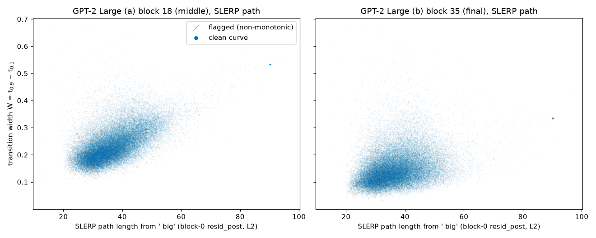
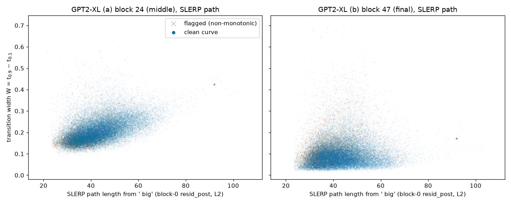
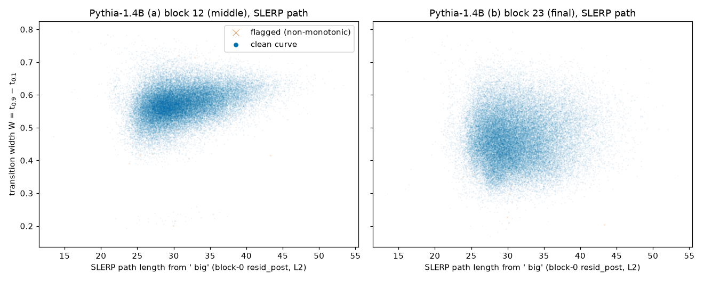
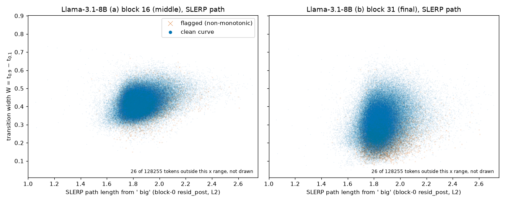
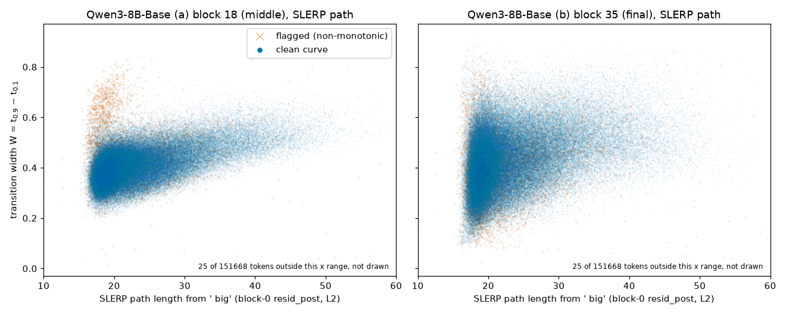

# Does distance after the first transformer block predict how sharply a model switches between two tokens?

## Summary

**Question.** Take the prompt "The house was big" and a second prompt that differs only in its last
token, B. Inside the model, just after the first transformer block, the last position holds one vector
for ` big` and another for B. We slide that vector in a straight line from the ` big` value to the B
value and watch a later layer. Sometimes the later layer switches from its ` big` state to its B state
abruptly, sometimes gradually. We ask: **does the distance between the two block-0 vectors predict how
wide that switch is?** We also redo the earlier descriptive questions: which tokens switch most slowly,
and do final-layer widths fall into groups?

**Why it matters.** Other experiments in this project interpolate between inputs and read "flat
stretch, then jump" shapes in the model's later layers. If the size of the injected change alone set
the width of the jump, those shapes would say little about how the model treats the two tokens.

**What changed from the earlier run.** The earlier run interpolated the input embedding and measured
distance between embeddings. This run moves both the interpolation and the distance to the output of
transformer block 0. Everything else is the same. The embedding-run report is kept in
`archive/embedding_run/REPORT.md`.

**Answer.** We swept every other vocabulary token in five models.

- **Middle of the network: yes in the GPT-2 models, weakly elsewhere.** In GPT-2 Large the median
  middle-block width rises from 0.196 for the nearest fifth of tokens to 0.276 for the farthest fifth
  (Figure 1a, Table 1), and GPT2-XL behaves the same way (0.170 to 0.225). Pythia 1.4B, Llama-3.1-8B
  and Qwen3-8B-Base rise by only 0.02–0.04, which is small next to the spread among tokens at one
  distance (Table 2). The embedding run showed no such trend in any model.
- **Final block: no consistent relationship.** The median final-block width changes by 0.02 or less
  across fifths in the GPT-2 models, falls slightly in Pythia, and rises slightly in the two 8B models
  (Table 2).
- **Distance is still a weak predictor of any one token.** In GPT-2 Large, five words at almost the
  same distance have final-block widths from 0.04 to 0.53 (Figure 4a).
- **Slowest switches.** They are still size words (` whopping`, ` giant`, ` huge`) and rarely seen,
  code-like strings, at distances both below and above the median (Finding 2).
- **Groups.** Final-block widths in GPT-2 Large form one broad peak with a long tail and no separate
  groups (Figure 3).
- **Does the straight-line path matter?** In a pilot on 256 GPT-2 Large pairs, the curved path of
  Matthew's experiments (SLERP) keeps the middle-block rise; the final-block rise is 0.02 under the
  straight line, 0.05 under SLERP, and 0.10–0.14 with his normalization (Finding 5, Table 3).
- **Full sweeps under SLERP, all five models.** The middle-block rise is present in all five models
  (Figures 9–13, Table 4). At the final block, width rises with SLERP path length in GPT-2 Large, Qwen3
  and Llama (Spearman rank correlation, defined in Finding 5: +0.33, +0.35, +0.21). GPT2-XL (+0.10) and
  Pythia (+0.02) show essentially no link. So the final-block answer depends on the path and the model.

## Methods

**Data & Model.** Five public language models, each with the same prompt "The house was big":
GPT-2 Large (774M parameters, 36 blocks, float32), GPT2-XL (1.5B, 48 blocks, float32), Pythia 1.4B
(24 blocks, float32), Llama-3.1-8B (32 blocks) and Qwen3-8B-Base (36 blocks). The two 8B models keep
their native 16-bit (bfloat16) weights, with the running hidden state held in float32. Endpoint A is
the prompt as written; its last token is ` big`. Endpoint B replaces only the last token ID with
another vocabulary ID. The text is never decoded and re-tokenized, so A and B differ in the last token
only. We swept every other token in each vocabulary: 50,256 tokens for the GPT-2 models, 50,276 for
Pythia, 128,255 for Llama and 151,668 for Qwen3. GPT-2 Large is the main model; the other four test
whether its result repeats.

**Where we interpolate.** A transformer keeps a running vector at each position, called the residual
stream; each block reads it and adds to it. We use the residual stream at the last position right
after block 0, the first block, has added its attention and MLP outputs. TransformerLens calls this
point `blocks.0.hook_resid_post`. In our code it is the output of the first block module
(`h[0]` in the GPT-2 models, `layers[0]` in the others). We first run A and B normally and store the
two vectors, r_A and r_B. Then, for 101 evenly spaced values of t, we run endpoint A again and
overwrite only the last-position output of block 0 with the straight-line mix:

```math
r(t) = (1-t)\,r_A + t\,r_B, \qquad t \in \lbrace 0, 0.01, \dots, 1 \rbrace
```

Earlier positions are left untouched, and every later block computes normally from the patched vector.

**Distance D.** To ask whether a larger injected change gives a wider switch, we need the size of the
change being injected. That is the plain Euclidean (L2) length of the interpolation path, measured in
the same space:

```math
D_B = \lVert r_B - r_A \rVert_2
```

D is the horizontal axis of Figures 1, 2 and 5–8 and the grouping variable of Tables 1 and 2. It is
not comparable in scale with the embedding distances of the earlier run (about 2.5 there, about 34
here for GPT-2 Large).

**Readout layers.** We read the last-position output of the middle block (block index n/2, counting
from 0; block 18 in GPT-2 Large) and of the final block, before the model's last normalization layer
(block 35 in GPT-2 Large).

**Progress y(t).** To put all tokens on one scale, we measure how far the readout has moved at step t
as a fraction of its full move. Here h_l(t) is the readout at layer l when r(t) is injected:

```math
y_l(t) = \frac{\lVert h_l(t) - h_l(0) \rVert_2}{\lVert h_l(1) - h_l(0) \rVert_2}
```

By construction y = 0 at the ` big` end and y = 1 at the B end. Figure 4 plots y(t) directly.

**Transition width W.** We need one number for how sharp the switch is. We use the stretch of t over
which the readout goes from 10% to 90% of the way to B:

```math
W_l = t_{0.9} - t_{0.1}
```

Here t_0.1 and t_0.9 are the first points where y crosses 0.1 and 0.9, found by straight-line
interpolation between neighbouring sampled points, with no smoothing. Small W means an abrupt jump;
W near 0.8 would be a straight ramp. W_mid is the width at the middle block and W_final at the final
block. W is the vertical axis of Figures 1, 2 and 5–8.

**Flag.** A curve is flagged when it crosses 0.1 or 0.9 more than once, or when y falls by more than
0.05 between neighbouring steps. Flagged curves stay in the data and are drawn as crosses.

**Checking the patch.** On 20–32 test tokens per model, the vector entering block 1 equalled r(t)
exactly, and at t = 0 and 1 the readouts matched unpatched runs of A and B (up to 2 in 100,000 in
float32; up to 3.4% from 16-bit rounding; RESULTS.md, R1).

**Path control (GPT-2 Large pilot).** The straight line is one of many paths between r_A and r_B, and
Matthew's experiments use a curved one. To ask whether Finding 1 depends on that choice, we ran both
paths on the same pairs. The curved path is the function `slerp_rescale` from `scripts/utils.py` of
`MShinkle/activation_plateau_mechanisms` (commit `4222c3e`). We call it SLERP (spherical linear
interpolation). It turns the vector's direction at a steady angular rate and sets its length to the
straight-line mix of the two endpoint lengths. With
unit directions u_A, u_B and lengths n_A, n_B:

```math
\theta = \arccos\lvert u_A \cdot u_B \rvert, \qquad
r_M(t) = \big((1-t)\,n_A + t\,n_B\big)\,\frac{\sin((1-t)\theta)\,u_A + \sin(t\theta)\,u_B}{\sin\theta}
```

The absolute value is in the published code and is kept; no pilot pair has a negative cosine. Our port
matches the reference to 8 in 10 million. The 256 token IDs were drawn at random (seed 0). Hook, grid,
readouts, W and the flag are unchanged (checks: RESULTS.md, R6).

Because the curved path is longer than the straight one, we report two distances. D is the distance
between the endpoints, as above, and is the same for both paths. The path length adds up the steps of
the path that is actually injected, on a fine grid of 2,000 steps:

```math
L_{path} = \sum_i \lVert r(t_{i+1}) - r(t_i) \rVert_2
```

Matthew's work also normalizes the readout differently, dividing by the sum of the distances to both
ends. So that a change of path is not confused with a change of normalization, the main comparison
uses our y(t) for both paths, and a separate comparison recomputes widths from the same forward passes
with his measure, where x(t) is the readout:

```math
y_{rel}(t) = \frac{\lVert x(t) - x(0) \rVert_2}{\lVert x(t) - x(0) \rVert_2 + \lVert x(t) - x(1) \rVert_2}
```

The two measures agree when the readout moves in a straight line and differ when its route bends.
Table 3 uses both.

**SLERP sweep (all five models).** After the pilot we reran the full sweep of every model with the
SLERP path in place of the straight line: same prompt, tokens, block-0 hook, 101-point grid, readout
blocks, y(t), W and flag. Only the injected vectors change. Here L_path is summed over the 100 steps
of the injected grid. The path starts at r_A and ends at r_B in every run (RESULTS.md, R7). Figures 9–13
draw every token, flagged ones as crosses. The final-block ρ of Table 4 keeps only curves that pass the
flag's two tests at the final block, so a token is not dropped for a problem at the middle block.

**Baselines.** There are none; the questions are descriptive and are answered from plots and medians.
The earlier embedding run is the reference we compare against. No statistical tests were run.

## Results

### Finding 1 — In GPT-2 Large, middle-block width rises with block-0 distance; final-block width barely does

If a larger injected change produced a wider switch, a scatter of W against D would slope upward. We
plot every token as one point:


**Figure 1.** GPT-2 Large. Each point is one token B. x: block-0 resid_post L2 distance D from ` big`;
y: transition width W. (a) block 18 (W_mid); (b) block 35 (W_final). Round dots = unflagged curves;
crosses = flagged curves. The isolated dot near D ≈ 77 is 75 rarely seen tokens (mostly fragments of
multi-byte characters) drawn close together.

Panel (a) tilts upward; panel (b) looks nearly level. To see the dense core more clearly, Figure 2
zooms in on the 5th–95th percentile of D (24.6–46.0, 45,232 tokens).


**Figure 2.** Zoom of Figure 1. x: D limited to 24.6–46.0; y: W, limited in each panel to the
smallest-to-largest W among tokens in that D range (block 18: 0.091–0.681; block 35: 0.033–0.684).
(a) block 18; (b) block 35. Round dots = unflagged curves; crosses = flagged curves.

Table 1 puts numbers on the two panels. It splits the vocabulary into five equal groups by D and gives
the median width in each, with the middle half of tokens in brackets.

| D range (fifth of tokens) | median W_mid (25th–75th pct.) | median W_final (25th–75th pct.) |
|---|---|---|
| 13.7–28.3 | 0.196 (0.177–0.220) | 0.110 (0.091–0.136) |
| 28.3–31.8 | 0.201 (0.178–0.227) | 0.119 (0.096–0.147) |
| 31.8–35.3 | 0.211 (0.186–0.242) | 0.123 (0.100–0.155) |
| 35.3–39.7 | 0.228 (0.198–0.265) | 0.127 (0.102–0.162) |
| 39.7–81.7 | 0.276 (0.234–0.320) | 0.128 (0.101–0.164) |

**Table 1.** GPT-2 Large, 10,052 tokens per row.

**Reading.** At block 18 the median width climbs in every step, from 0.196 to 0.276, and most of the
climb is in the farthest two fifths. The shift between the nearest and farthest fifth (0.08) is larger
than the spread of the middle half of tokens inside a fifth (about 0.04–0.09 wide), so the trend is
visible but the groups still overlap. At block 35 the median moves from 0.110 to 0.128, small next to
the within-group spread of about 0.05–0.06. This is an association in one prompt; we did not test what
produces it.

**Comparison with the embedding run.** There, the same table was flat at block 18 (0.184–0.199) and
nearly flat at block 35 (0.104–0.130). So the block-0 site changes the middle-block answer and leaves
the final-block answer about the same. 98.4% of tokens are narrower at the final block, and 2.1% of
curves are flagged (5.5% before).

### Finding 2 — Tokens at the same distance still differ widely, and the slowest switches are size words and rare strings

Table 1 describes medians. To show how much single tokens differ at one distance, we took the 3,859
tokens whose D is within 2% of the vocabulary median (32.9–34.2) and picked the lowercase words nearest
the minimum, 25th, 50th and 75th percentile, and maximum of W_final in that band. Figure 4a (below)
plots their curves: W_final runs from 0.042 (` pres`) to 0.533 (` hefty`), while the middle half of the
band lies between 0.099 and 0.155.

The slowest final-block switches are not the farthest tokens. The 100 widest have median D 35.3, close
to the vocabulary median of 33.5. We listed every token at least as wide as B = ` large`
(W_final 0.533): 28 other tokens, 0.06% of the vocabulary
(`results/block0_resid_post/tokens_W_final_ge_large.csv`). By our reading, 15 are size or amount words
(` whopping`, ` giant`, ` HUGE`, ` tremendous`, ` huge`, ` hefty`, …), 9 are code-like or multi-byte
strings (`Downloadha`, ` guiActiveUnfocused`, `TPPStreamerBot`, …), and 4 are other words or pieces. Their D spans 15.9 (` huge`) to
63.0: the size words sit at D 16–39 and the rare strings at D 37–63, on both sides of the median.
22 of these 29 tokens were also on the
embedding run's list of 53. We did not test why these tokens switch slowly.

### Finding 3 — Final-block widths form one broad peak

If tokens fell into distinct switch types, the histogram of W_final would have separate peaks and the
sorted widths would show flat steps. We plot both:


**Figure 3.** GPT-2 Large. (a) Histogram of W_final over all 50,256 tokens (200 bins); x: W_final,
y: number of tokens. (b) The same widths sorted; x: token rank, y: W_final.

The histogram has a single peak near W_final ≈ 0.11 and a long tail to 0.68. The sorted curve rises
smoothly with no flat steps. The embedding run had one small extra spike, made by 64 rarely seen tokens
with near-identical embeddings. Those tokens are still far from everything else here (D 66–77), but
their final-block widths now spread from 0.16 to 0.31, and no spike appears.

To confirm that W reflects visibly different curve shapes, we plot final-block curves directly:


**Figure 4.** GPT-2 Large, final-block progress y(t). x: interpolation position t (0 = ` big`,
1 = token B); y: y(t). Dotted lines mark 0.1 and 0.9. Line style and marker identify each token; the
legend gives its W_final and D. (a) The five words from Finding 2, all with D between 32.9 and 34.2.
(b) Five tokens from the most common histogram bin (W_final 0.111–0.114).

In panel (a), small W is a near-vertical jump (` pres`) and large W is a slow ramp (` hefty`). In panel
(b), tokens with the same W share the same steep shape but switch at different points (t ≈ 0.3 for
four far-away word pieces, t ≈ 0.55 for ` money`), and their D ranges from 20.6 to 69.0.

### Finding 4 — The other four models

To see whether Finding 1 is specific to GPT-2 Large, Figures 5–8 repeat Figure 1 for each other model,
and Table 2 gives the nearest-fifth and farthest-fifth medians for all five.


**Figure 5.** GPT2-XL. Same layout as Figure 1: x: block-0 resid_post L2 distance D from ` big`;
y: W. (a) block 24 (middle); (b) block 47 (final). Round dots = unflagged; crosses = flagged.

GPT2-XL repeats GPT-2 Large: an upward tilt at the middle block and a level cloud at the final block.


**Figure 6.** Pythia 1.4B. Same axes and markers as Figure 5. (a) block 12 (middle); (b) block 23
(final).

Pythia differs. Its middle-block cloud tilts up only slightly, and its final-block cloud tilts slightly
down.


**Figure 7.** Llama-3.1-8B. Same axes and markers as Figure 5. (a) block 16 (middle); (b) block 31
(final). The x-axis is limited to D from 1 to 2.5. Nine in ten tokens have D between 1.56 and 1.90.
Of 128,255 tokens, 26 fall outside the plotted range and are not drawn (3 below 1; 23 above 2.5, the
farthest at D ≈ 16.5).


**Figure 8.** Qwen3-8B-Base. Same axes and markers as Figure 5. (a) block 18 (middle); (b) block 35
(final). The x-axis is limited to D from 10 to 55. Of 151,668 tokens, 20 fall outside the plotted range
and are not drawn (4 below 10; 16 above 55, the farthest at D ≈ 103).

Llama's cloud is a compact blob with at most a slight upward lean at the middle block, and Qwen3's
cloud shows no obvious tilt by eye. Table 2 shows small rises at both blocks in both models.


| Model | Site | W_mid: nearest → farthest fifth | W_final: nearest → farthest fifth | Final narrower |
|---|---|---|---|---|
| GPT-2 Large | block 0 | 0.196 → 0.276 | 0.110 → 0.128 | 98.4% |
| GPT-2 Large | embedding | 0.184 → 0.199 | 0.104 → 0.130 | 97.7% |
| GPT2-XL | block 0 | 0.170 → 0.225 | 0.070 → 0.075 | 97.7% |
| GPT2-XL | embedding | 0.167 → 0.182 | 0.086 → 0.101 | 95.3% |
| Pythia 1.4B | block 0 | 0.550 → 0.579 | 0.466 → 0.427 | 93.0% |
| Pythia 1.4B | embedding | 0.435 → 0.413 | 0.341 → 0.317 | 95.8% |
| Llama-3.1-8B | block 0 | 0.339 → 0.375 | 0.230 → 0.266 | 93.6% |
| Llama-3.1-8B | embedding | 0.280 → 0.281 | 0.199 → 0.205 | 88.8% |
| Qwen3-8B-Base | block 0 | 0.312 → 0.335 | 0.290 → 0.312 | 59.8% |
| Qwen3-8B-Base | embedding | 0.239 → 0.217 | 0.215 → 0.220 | 56.2% |

**Table 2.** Median width in the nearest and farthest fifth of tokens by D, for the block-0 run and,
for reference, the earlier embedding run (where D is embedding distance). "Final narrower" is the share
of tokens with W_final < W_mid. All five-group values are in RESULTS.md, R3.

**Reading.** At the middle block, the farthest fifth has a wider median than the nearest fifth in all
five models. In the GPT-2 models the shift (0.06–0.08) is about as large as the within-fifth spread;
in Pythia, Llama and Qwen3 it is 0.02–0.04, half or less of that spread. At the final block the direction is not shared: about level in the GPT-2 models,
down by 0.04 in Pythia, and up by 0.02–0.04 in Llama and Qwen3, where the within-fifth spread is
0.10–0.13. In the embedding run the middle-block medians moved by about 0.02 or less and fell in two models.
The final block is narrower than the middle block for most tokens in four models; Qwen3 remains the
exception at 59.8%: its two medians (0.307 final, 0.325 middle) differ by only 0.018.

### Finding 5 — A curved interpolation path keeps the middle-block trend; the final-block trend depends on path and normalization

Finding 1 used a straight-line path. Here we ask whether it survives the curved path of Matthew's
experiments, on 256 random GPT-2 Large pairs run under both paths (Methods, "Path control"). The curved
path is 3.7% to 15.6% longer than the endpoint distance (median 7.5%). Table 3 groups the pairs into
fifths by endpoint distance D and gives the median width per fifth.

| normalization, block | path | nearest fifth | 2nd | 3rd | 4th | farthest fifth |
|---|---|---|---|---|---|---|
| ours (y), middle | straight | 0.197 | 0.198 | 0.207 | 0.233 | 0.259 |
| ours (y), middle | curved | 0.189 | 0.203 | 0.217 | 0.255 | 0.282 |
| ours (y), final | straight | 0.114 | 0.105 | 0.117 | 0.143 | 0.136 |
| ours (y), final | curved | 0.113 | 0.116 | 0.133 | 0.164 | 0.163 |
| relative (y_rel), middle | straight | 0.356 | 0.381 | 0.445 | 0.468 | 0.507 |
| relative (y_rel), middle | curved | 0.329 | 0.346 | 0.391 | 0.411 | 0.431 |
| relative (y_rel), final | straight | 0.280 | 0.276 | 0.345 | 0.368 | 0.421 |
| relative (y_rel), final | curved | 0.264 | 0.268 | 0.317 | 0.344 | 0.367 |

**Table 3.** GPT-2 Large pilot, median W by fifth of endpoint distance D. Rows with our normalization
use the 245 pairs unflagged under both paths (48–50 per fifth); 11 pairs flagged under the straight
path, 5 of them also under the curved path, are left out. Rows with the relative normalization use all
256 pairs (51–52 per fifth); none is flagged.

**Middle block.** With our normalization the median width rises with distance under both paths (0.197
to 0.259 straight, 0.189 to 0.282 curved). Grouping by L_path instead of D changes the medians by at
most 0.003. Single-pair widths change little (median curved minus straight: +0.009 middle, +0.016
final; RESULTS.md, R6).

**Final block.** Here the reading is less stable. The rise from the nearest to the farthest fifth is
0.02 with the straight path, as in Finding 1, and 0.05 with the curved path. With the relative
normalization, computed from the same forward passes, it is 0.14 for the straight path and 0.10 for
the curved one; it also gives much larger widths overall (RESULTS.md, R6). We did not test why the
two normalizations differ. This is a pilot: one model, about 50 pairs per fifth, no statistical test.

**All five models, full vocabulary.** Do Findings 1 and 4 hold when every model's full sweep uses
SLERP (Methods, "SLERP sweep")? Figures 9–13 repeat Figures 1 and 5–8 with SLERP: same layout, panels
and markers, with SLERP path length L_path on the x-axis. Llama and Qwen3 have a few far tokens, so
their panels show only the majority region, as in Figures 7 and 8.



**Figure 9.** GPT-2 Large under SLERP. x: SLERP path length L_path from ` big` (block-0 output, L2);
y: W measured along the SLERP path. (a) block 18 (middle); (b) block 35 (final). Round dots = unflagged;
crosses = flagged.

GPT-2 Large keeps its clear middle-block tilt, and its final-block cloud now also leans upward.



**Figure 10.** GPT2-XL under SLERP. Same axes and markers as Figure 9. (a) block 24; (b) block 47.

GPT2-XL keeps the middle-block tilt; its final-block cloud stays nearly level.



**Figure 11.** Pythia 1.4B under SLERP. Same axes and markers as Figure 9. (a) block 12; (b) block 23.

Pythia's middle-block cloud tilts up slightly; its final-block cloud is level, where under the straight
line it tilted down.



**Figure 12.** Llama-3.1-8B under SLERP. Same axes and markers as Figure 9. (a) block 16; (b) block 31.
The x-axis is limited to L_path from 1 to 2.75 (Figure 7's range stretched by the typical ratio of
L_path to D); 26 of 128,255 tokens fall outside it and are not drawn.

Llama remains a compact blob with a slight upward lean in both panels. Qwen3 is shown, as in Figure 8,
on a limited x range:



**Figure 13.** Qwen3-8B-Base under SLERP. Same axes and markers as Figure 9. (a) block 18; (b) block 35.
The x-axis is limited to L_path from 10 to 60; 25 of 151,668 tokens are not drawn.

Qwen3's clouds fan out to wider
widths at larger path lengths, at both blocks. To put one number on the final-block clouds we use the
Spearman rank correlation ρ: the Pearson correlation of the tokens' ranks by distance with their ranks
by width. ρ is +1 when width always grows with distance, −1 when it always shrinks, and near 0 when
there is no monotonic link. Table 4 compares the two paths.

| Model | W_mid under SLERP, nearest → farthest fifth | final-block ρ, straight line | final-block ρ, SLERP | W_final under SLERP, nearest → farthest fifth |
|---|---|---|---|---|
| GPT-2 Large | 0.192 → 0.294 | +0.15 | +0.33 | 0.115 → 0.162 |
| GPT2-XL | 0.170 → 0.251 | +0.05 | +0.10 | 0.077 → 0.087 |
| Pythia 1.4B | 0.555 → 0.599 | −0.15 | +0.02 | 0.467 → 0.473 |
| Llama-3.1-8B | 0.404 → 0.450 | +0.15 | +0.21 | 0.289 → 0.351 |
| Qwen3-8B-Base | 0.370 → 0.472 | +0.09 | +0.35 | 0.371 → 0.500 |

**Table 4.** Full vocabularies. Fifths are by L_path. The W_mid column uses all tokens, like Table 2.
The ρ and W_final columns use only tokens whose final-block curve passes the flag's tests
(46,857–139,182 per model under SLERP). Straight-line ρ uses D; SLERP ρ uses L_path, and ρ against D
differs by at most 0.014 (RESULTS.md, R7).

**Middle block.** The farthest fifth has a wider median than the nearest fifth in all five models, as
under the straight line (Table 2). The rise is 0.08–0.10 in GPT-2 Large, GPT2-XL and Qwen3, and
0.04–0.05 in Pythia and Llama.

**Final block.** SLERP gives a higher ρ than the straight line in every model, but only three models
show a real positive link: GPT-2 Large (+0.33) and Qwen3 (+0.35), with Llama weaker (+0.21). GPT2-XL
(+0.10) and Pythia (+0.02) show essentially none. L_path and D have Pearson r of 0.995 or more in every
model, so using D on the x-axis would not change this. These are correlations across tokens for one
prompt; we did not test why the path matters.

## Conclusion

For "The house was big", measuring both the interpolation and the distance at the output of block 0
gives a different picture from the embedding run at the middle of the network and a similar one at the
end.

- **Middle block.** Tokens that are farther from ` big` after block 0 tend to switch more gradually
  in GPT-2 Large and GPT2-XL (Figures 1 and 5; Tables 1 and 2). Pythia 1.4B, Llama-3.1-8B and
  Qwen3-8B-Base show the same direction but only a small shift (Figures 6–8, Table 2).
- **Final block, straight-line path.** No consistent relationship: about level in the GPT-2 models, slightly falling in
  Pythia, slightly rising in Llama and Qwen3 (Table 2).
- **Single tokens.** Distance leaves most of the variation unexplained. Words at the same distance
  range from a near-vertical jump to a slow ramp (Figure 4a), and the slowest switches come from size
  words and rare strings at many distances (Finding 2).
- **Groups.** GPT-2 Large final-block widths form one broad peak (Figure 3).
- **Path.** Under SLERP the middle-block rise holds in all five models. The final-block link becomes
  positive in GPT-2 Large, Qwen3 and Llama (ρ +0.21 to +0.35) and stays near zero in GPT2-XL and Pythia
  (Figures 9–13, Table 4). The 256-pair GPT-2 Large pilot shows the final-block rise also grows with the
  relative normalization (Table 3).

For the plateau experiments, this suggests that block-0 distance carries some information about switch
width partway through the network. At the final block, how much it carries depends on the injected path
and the model: little under the straight line; under SLERP, a weak-to-moderate positive link in three
of five models.

**Limitations.**
- One prompt and one anchor token. All relationships here are associations across tokens; no
  experiment tested a cause.
- The relative normalization was tried only in the GPT-2 Large pilot (256 pairs).
- W uses only the first crossing of each level, so it describes flagged curves less well.
- In the two 16-bit models, rounding limits W to about 0.03 in the worst checked case (typically 0.001–0.003) (RESULTS.md, R1).
