# RESULTS — Block-0 distance vs. transition width ("The house was big", five models)

This file is the detailed evidence record for the block-0 rerun. The concise write-up is `REPORT.md`,
which defines every term used here. The earlier embedding-run record is in
`archive/embedding_run/RESULTS.md`; its data and plots are unchanged in `results/` and `plots/`.

**Setup in one line.** For each other vocabulary token B, we run "The house was big" and the same
prompt ending in B, and store the last-position output of transformer block 0 (r_A, r_B). We then run
the ` big` prompt 101 times, each time overwriting only that vector with (1 − t)·r_A + t·r_B for t from
0 to 1. At the middle block and the final block we measure how far the last-position output has moved
as a fraction of its full move, y(t). The transition width is W = t_0.9 − t_0.1 (first crossings).
D is the L2 distance between r_A and r_B. Run metadata (`intervention_site` and `distance_space`, both
`block0_resid_post`) is in `results/block0_resid_post/sweep/meta.json` and
`results/block0_resid_post/gen/<model>/meta.json`.

## R1 — Checks on the patch

Before each sweep we ran full-prompt forward passes on a small token set (the 20 hand-picked tokens of
the original sanity check for GPT-2 Large; 32 random tokens, seed 0, for the others). The table reports
the worst case over those tokens. "Injected vs r(t)" compares the vector entering block 1 at the last
position with r(t). "Prefix" compares the vectors entering block 1 at the earlier positions with an
unpatched run of A. The last two columns compare the raw readout vectors of the patched run at t = 0
and t = 1 with separate unpatched runs of A and B, as relative L2 difference. Files:
`results/block0_resid_post/validate/*.json`.

| Model | Hook (block-0 output) | Tokens | Injected vs r(t), max abs | Prefix vs unpatched A, max abs | Readout at t=0 vs unpatched A (mid / final) | Readout at t=1 vs unpatched B (mid / final) |
|---|---|---|---|---|---|---|
| GPT-2 Large | `GPT2Model.h[0] output` | 20 | 0e+00 | 4.8e-06 | 6.1e-07 / 5.2e-07 | 1.1e-06 / 1.5e-06 |
| GPT2-XL | `GPT2Model.h[0] output` | 32 | 0e+00 | 9.5e-06 | 4.6e-07 / 3.4e-07 | 1.3e-06 / 1.3e-06 |
| Pythia 1.4B | `GPTNeoXModel.layers[0] output` | 32 | 0e+00 | 5.7e-06 | 8.3e-07 / 1.0e-05 | 1.8e-06 / 2.0e-05 |
| Llama-3.1-8B | `LlamaModel.layers[0] output` | 32 | 0e+00 | 1.6e-02 | 5.6e-03 / 8.2e-03 | 2.8e-02 / 3.4e-02 |
| Qwen3-8B-Base | `Qwen3Model.layers[0] output` | 32 | 0e+00 | 1.1e-01 | 9.8e-03 / 9.9e-03 | 2.4e-02 / 1.9e-02 |

The injected vector is exact in every model. The three float32 models agree with unpatched runs to
rounding error. The two 8B models keep 16-bit weights; their readouts differ by up to 3.4% between a
patched batch of 101 and an unpatched run of a different batch size, and their prefix vectors (which
have very large norms in these models) differ by up to 0.11 in one coordinate. The embedding run showed
differences of the same order between batch shapes in these models. We did not isolate the source
further.

For the four models that run only the last position against stored prefix keys and values, the sweep
also compares that fast path with full-prompt patched runs on 32 tokens. The table gives the readout
difference and the resulting difference in W:

| Model | Tokens per forward | Readout difference, max relative (mid / final) | Width difference, median (mid / final) | Width difference, max (mid / final) |
|---|---|---|---|---|
| GPT2-XL | 64 x 101 | 3.4e-06 / 6.2e-06 | 6.6e-08 / 1.5e-07 | 3.1e-07 / 1.2e-06 |
| Pythia 1.4B | 64 x 101 | 2.4e-06 / 3.4e-05 | 2.5e-07 / 3.1e-06 | 6.1e-07 / 8.2e-06 |
| Llama-3.1-8B | 128 x 101 | 2.0e-02 / 6.3e-02 | 7.8e-04 / 1.3e-03 | 2.6e-03 / 3.0e-02 |
| Qwen3-8B-Base | 128 x 101 | 2.4e-02 / 2.8e-02 | 7.9e-04 / 3.5e-03 | 3.8e-03 / 2.4e-02 |

So W is exact to about 1e-5 in the float32 models. In the 8B models it is typically good to 0.001–0.003
and in the worst checked token to 0.03. GPT-2 Large always runs the full prompt (8 tokens x 101 per
forward), as in the embedding run. Batch sizes are the same as in the embedding run.

## R2 — Sweep summary

Every other vocabulary token was swept in each model; none was excluded. The table summarizes D, the
two widths, the share of tokens whose final-block width is narrower than their middle-block width, and
the number of flagged curves (0.1 or 0.9 crossed more than once, or y dropping by more than 0.05 in one
step). Embedding-run rows are given for reference; their D is embedding distance. Per-token rows:
`results/block0_resid_post/sweep.csv` (GPT-2 Large) and `results/block0_resid_post/gen/<model>.csv`.
The same numbers are in `results/block0_resid_post/summary_all.json`.

| Model | Site | Tokens | D: min / 5% / median / 95% / max | W_mid: 5% / 25% / median / 75% / 95% | W_final: 5% / 25% / median / 75% / 95% | Final narrower | Flagged mid / final / either |
|---|---|---|---|---|---|---|---|
| GPT-2 Large | block 0 | 50,256 | 13.65 / 24.56 / 33.53 / 45.99 / 81.69 | 0.158 / 0.188 / 0.216 / 0.258 / 0.345 | 0.072 / 0.097 / 0.121 / 0.153 / 0.231 | 98.4% | 36 / 1,012 / 1,043 (2.1%) |
| GPT-2 Large | embedding | 50,256 | 1.22 / 2.14 / 2.51 / 2.89 / 5.17 | 0.138 / 0.168 / 0.195 / 0.229 / 0.293 | 0.061 / 0.086 / 0.112 / 0.148 / 0.232 | 97.7% | 163 / 2,686 / 2,788 (5.5%) |
| GPT2-XL | block 0 | 50,256 | 17.81 / 28.64 / 39.34 / 54.91 / 91.65 | 0.136 / 0.163 / 0.188 / 0.224 / 0.298 | 0.032 / 0.053 / 0.077 / 0.110 / 0.200 | 97.7% | 1 / 4,302 / 4,303 (8.6%) |
| GPT2-XL | embedding | 50,256 | 1.17 / 2.00 / 2.34 / 2.68 / 3.99 | 0.124 / 0.150 / 0.174 / 0.206 / 0.276 | 0.031 / 0.058 / 0.089 / 0.131 / 0.234 | 95.3% | 12 / 5,803 / 5,808 (11.6%) |
| Pythia 1.4B | block 0 | 50,276 | 13.36 / 24.46 / 29.04 / 36.52 / 48.34 | 0.475 / 0.531 / 0.563 / 0.593 / 0.643 | 0.332 / 0.391 / 0.444 / 0.504 / 0.595 | 93.0% | 0 / 121 / 121 (0.2%) |
| Pythia 1.4B | embedding | 50,276 | 0.94 / 1.35 / 1.39 / 1.42 / 1.47 | 0.355 / 0.397 / 0.423 / 0.451 / 0.502 | 0.236 / 0.286 / 0.328 / 0.372 / 0.449 | 95.8% | 0 / 109 / 109 (0.2%) |
| Llama-3.1-8B | block 0 | 128,255 | 0.83 / 1.56 / 1.70 / 1.90 / 16.53 | 0.276 / 0.320 / 0.354 / 0.390 / 0.451 | 0.128 / 0.196 / 0.246 / 0.300 / 0.388 | 93.6% | 132 / 5,727 / 5,830 (4.5%) |
| Llama-3.1-8B | embedding | 128,255 | 0.58 / 0.81 / 0.91 / 0.97 / 1.13 | 0.214 / 0.251 / 0.279 / 0.311 / 0.367 | 0.104 / 0.159 / 0.203 / 0.254 / 0.346 | 88.8% | 604 / 9,617 / 9,855 (7.7%) |
| Qwen3-8B-Base | block 0 | 151,668 | 7.41 / 16.41 / 19.58 / 32.30 / 103.03 | 0.249 / 0.292 / 0.325 / 0.361 / 0.427 | 0.176 / 0.246 / 0.307 / 0.380 / 0.504 | 59.8% | 118 / 19,015 / 19,059 (12.6%) |
| Qwen3-8B-Base | embedding | 151,668 | 1.82 / 1.93 / 2.33 / 2.49 / 2.66 | 0.170 / 0.205 / 0.233 / 0.264 / 0.318 | 0.117 / 0.176 / 0.230 / 0.298 / 0.425 | 56.2% | 182 / 32,209 / 32,260 (21.3%) |

Widths are larger in the block-0 run than in the embedding run in every model except GPT2-XL's final
block. Fewer curves are flagged in four models; Pythia is unchanged at 0.2%.

## R3 — Median width by distance group

Each model's tokens are split into five equal groups by D. The table gives the median width in each
group with the 25th–75th percentile in brackets. It summarizes the scatter plots; it is not a
statistical test.

| Model | Site | Fifth | D range | median W_mid (25th–75th) | median W_final (25th–75th) |
|---|---|---|---|---|---|
| GPT-2 Large | block 0 | 1 | 13.65–28.33 | 0.196 (0.177–0.220) | 0.110 (0.091–0.136) |
| GPT-2 Large | block 0 | 2 | 28.33–31.80 | 0.201 (0.178–0.227) | 0.119 (0.096–0.147) |
| GPT-2 Large | block 0 | 3 | 31.80–35.31 | 0.211 (0.186–0.242) | 0.123 (0.100–0.155) |
| GPT-2 Large | block 0 | 4 | 35.31–39.66 | 0.228 (0.198–0.265) | 0.127 (0.102–0.162) |
| GPT-2 Large | block 0 | 5 | 39.66–81.69 | 0.276 (0.234–0.320) | 0.128 (0.101–0.164) |
| GPT-2 Large | embedding | 1 | 1.22–2.32 | 0.184 (0.160–0.222) | 0.104 (0.080–0.144) |
| GPT-2 Large | embedding | 2 | 2.32–2.45 | 0.196 (0.170–0.233) | 0.112 (0.086–0.146) |
| GPT-2 Large | embedding | 3 | 2.45–2.57 | 0.199 (0.171–0.230) | 0.106 (0.083–0.137) |
| GPT-2 Large | embedding | 4 | 2.57–2.71 | 0.196 (0.168–0.226) | 0.107 (0.085–0.139) |
| GPT-2 Large | embedding | 5 | 2.71–5.17 | 0.199 (0.172–0.231) | 0.130 (0.101–0.169) |
| GPT2-XL | block 0 | 1 | 17.81–33.05 | 0.170 (0.152–0.192) | 0.070 (0.048–0.098) |
| GPT2-XL | block 0 | 2 | 33.05–37.28 | 0.176 (0.156–0.204) | 0.079 (0.055–0.110) |
| GPT2-XL | block 0 | 3 | 37.28–41.52 | 0.186 (0.162–0.216) | 0.081 (0.056–0.114) |
| GPT2-XL | block 0 | 4 | 41.52–46.75 | 0.199 (0.173–0.232) | 0.081 (0.056–0.119) |
| GPT2-XL | block 0 | 5 | 46.75–91.65 | 0.225 (0.192–0.263) | 0.075 (0.049–0.112) |
| GPT2-XL | embedding | 1 | 1.17–2.17 | 0.167 (0.146–0.200) | 0.086 (0.052–0.133) |
| GPT2-XL | embedding | 2 | 2.17–2.29 | 0.173 (0.149–0.206) | 0.090 (0.058–0.133) |
| GPT2-XL | embedding | 3 | 2.29–2.40 | 0.174 (0.150–0.204) | 0.084 (0.054–0.120) |
| GPT2-XL | embedding | 4 | 2.40–2.52 | 0.175 (0.150–0.206) | 0.087 (0.057–0.126) |
| GPT2-XL | embedding | 5 | 2.52–3.99 | 0.182 (0.157–0.213) | 0.101 (0.067–0.143) |
| Pythia 1.4B | block 0 | 1 | 13.36–26.41 | 0.550 (0.515–0.584) | 0.466 (0.417–0.520) |
| Pythia 1.4B | block 0 | 2 | 26.41–28.14 | 0.556 (0.526–0.587) | 0.447 (0.393–0.506) |
| Pythia 1.4B | block 0 | 3 | 28.14–30.04 | 0.558 (0.528–0.589) | 0.442 (0.391–0.501) |
| Pythia 1.4B | block 0 | 4 | 30.04–32.69 | 0.566 (0.535–0.595) | 0.434 (0.384–0.495) |
| Pythia 1.4B | block 0 | 5 | 32.69–48.34 | 0.579 (0.551–0.605) | 0.427 (0.373–0.491) |
| Pythia 1.4B | embedding | 1 | 0.94–1.37 | 0.435 (0.404–0.471) | 0.341 (0.291–0.391) |
| Pythia 1.4B | embedding | 2 | 1.37–1.39 | 0.426 (0.400–0.455) | 0.332 (0.289–0.376) |
| Pythia 1.4B | embedding | 3 | 1.39–1.40 | 0.423 (0.399–0.449) | 0.328 (0.288–0.369) |
| Pythia 1.4B | embedding | 4 | 1.40–1.41 | 0.419 (0.395–0.445) | 0.324 (0.285–0.366) |
| Pythia 1.4B | embedding | 5 | 1.41–1.47 | 0.413 (0.390–0.437) | 0.317 (0.280–0.359) |
| Llama-3.1-8B | block 0 | 1 | 0.83–1.63 | 0.339 (0.307–0.374) | 0.230 (0.182–0.281) |
| Llama-3.1-8B | block 0 | 2 | 1.63–1.68 | 0.351 (0.319–0.384) | 0.242 (0.195–0.294) |
| Llama-3.1-8B | block 0 | 3 | 1.68–1.72 | 0.351 (0.320–0.384) | 0.243 (0.197–0.295) |
| Llama-3.1-8B | block 0 | 4 | 1.72–1.79 | 0.355 (0.323–0.391) | 0.250 (0.201–0.305) |
| Llama-3.1-8B | block 0 | 5 | 1.79–16.53 | 0.375 (0.337–0.419) | 0.266 (0.210–0.323) |
| Llama-3.1-8B | embedding | 1 | 0.58–0.87 | 0.280 (0.249–0.316) | 0.199 (0.151–0.263) |
| Llama-3.1-8B | embedding | 2 | 0.87–0.90 | 0.276 (0.249–0.308) | 0.198 (0.155–0.246) |
| Llama-3.1-8B | embedding | 3 | 0.90–0.92 | 0.278 (0.251–0.309) | 0.204 (0.161–0.252) |
| Llama-3.1-8B | embedding | 4 | 0.92–0.94 | 0.278 (0.249–0.310) | 0.208 (0.163–0.256) |
| Llama-3.1-8B | embedding | 5 | 0.94–1.13 | 0.281 (0.255–0.312) | 0.205 (0.165–0.255) |
| Qwen3-8B-Base | block 0 | 1 | 7.41–17.44 | 0.312 (0.283–0.345) | 0.290 (0.232–0.360) |
| Qwen3-8B-Base | block 0 | 2 | 17.44–18.68 | 0.322 (0.292–0.355) | 0.305 (0.244–0.376) |
| Qwen3-8B-Base | block 0 | 3 | 18.68–20.84 | 0.330 (0.296–0.365) | 0.316 (0.252–0.389) |
| Qwen3-8B-Base | block 0 | 4 | 20.84–24.90 | 0.327 (0.290–0.365) | 0.312 (0.249–0.386) |
| Qwen3-8B-Base | block 0 | 5 | 24.90–103.03 | 0.335 (0.301–0.373) | 0.312 (0.254–0.386) |
| Qwen3-8B-Base | embedding | 1 | 1.82–2.20 | 0.239 (0.209–0.270) | 0.215 (0.161–0.288) |
| Qwen3-8B-Base | embedding | 2 | 2.20–2.30 | 0.243 (0.216–0.274) | 0.244 (0.189–0.309) |
| Qwen3-8B-Base | embedding | 3 | 2.30–2.36 | 0.235 (0.209–0.265) | 0.238 (0.186–0.305) |
| Qwen3-8B-Base | embedding | 4 | 2.36–2.42 | 0.228 (0.202–0.259) | 0.232 (0.178–0.299) |
| Qwen3-8B-Base | embedding | 5 | 2.42–2.66 | 0.217 (0.192–0.248) | 0.220 (0.168–0.286) |

In the block-0 run the middle-block median rises from the first to the fifth group in all five models:
by 0.080 (GPT-2 Large), 0.055 (GPT2-XL), 0.029 (Pythia), 0.036 (Llama) and 0.023 (Qwen3). The
final-block median changes by +0.018, +0.005, −0.039, +0.036 and +0.022. In the embedding run the
middle-block changes were +0.015, +0.015, −0.022, +0.001 and −0.022.

## R4 — GPT-2 Large

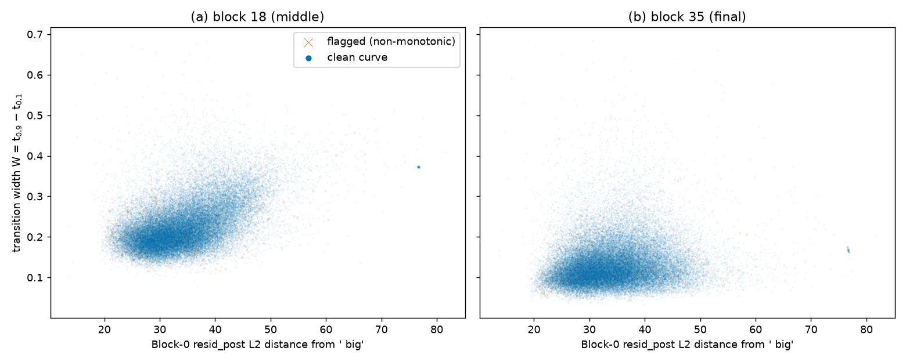

**Figure 1.** GPT-2 Large. Each point is one token B. x: block-0 resid_post L2 distance D from ` big`;
y: transition width W. (a) block 18, (b) block 35. Round dots = unflagged curves; crosses = flagged
curves.

The cloud tilts upward at block 18 and is nearly level at block 35. The isolated dot near D ≈ 77 is a
group of 75 tokens with D > 70, mostly fragments of multi-byte characters. It contains 61 of the 64 rarely seen tokens that formed the D ≈ 5.17 group in the embedding run (those
64 have D 66.2–77.0 here, W_final 0.161–0.314, median 0.168). Over the 75 tokens, W_mid has median
0.373 and W_final ranges from 0.077 to 0.303 (median 0.168). To show the dense core, Figure 2 zooms in on the 5th–95th percentile of D.

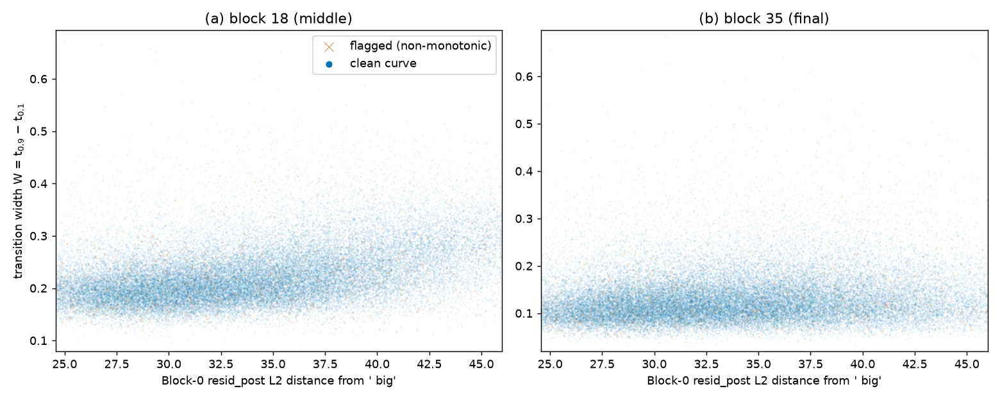

**Figure 2.** Zoom of Figure 1. x: D limited to 24.56–45.99 (45,232 tokens); y: W limited to the
smallest-to-largest W in that range (block 18: 0.091–0.681; block 35: 0.033–0.684). Same panels and
markers as Figure 1.

The table below uses fixed D ranges, which separate the sparse edges from the core:

| D range | tokens | median W_mid | median W_final |
|---|---|---|---|
| < 20 | 69 | 0.231 | 0.109 |
| 20–30 | 14,729 | 0.197 | 0.112 |
| 30–40 | 26,021 | 0.215 | 0.124 |
| 40–50 | 8,528 | 0.273 | 0.128 |
| 50–70 | 834 | 0.339 | 0.125 |
| > 70 | 75 | 0.373 | 0.168 |

The tokens nearest ` big` are `big` (D 13.65), ` Big`, `Big`, ` biggest`, ` bigger`, ` huge`, ` bad`
and ` little`. Several of them have very wide switches (` huge`: W_mid 0.652, W_final 0.590), which
raises the median W_mid of the 69 tokens below D = 20.

To check for groups of final-block widths, Figure 3 shows their histogram and sorted values.

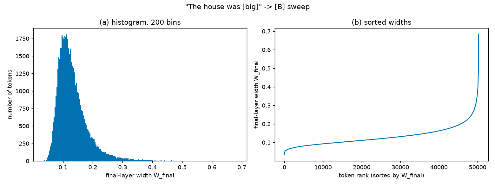

**Figure 3.** GPT-2 Large. (a) Histogram of W_final (200 bins); x: W_final, y: number of tokens.
(b) The same values sorted; x: token rank, y: W_final.

There is one peak (most common bin 0.111–0.114, 1,809 tokens) and a tail to 0.684. The sorted curve has
no flat steps. The table lists, for each W_final band, the tokens with the lowest D. These are examples
only; no clustering was run.

| W_final band | tokens | lowest-D examples |
|---|---|---|
| < 0.05 | 112 | ` "`, ` she`, ` By`, ` n`, ` k`, `\n\n` |
| 0.05–0.10 | 13,849 | ` go`, ` so`, ` very`, ` getting`, ` to`, ` what` |
| 0.10–0.15 | 22,784 | ` much`, ` just`, ` get`, ` got`, ` really`, ` it` |
| 0.15–0.20 | 8,876 | `big`, ` Big`, ` good`, ` bit`, ` lot`, ` pretty` |
| 0.20–0.30 | 3,833 | `Big`, ` bad`, ` high`, ` whole`, ` old`, ` new` |
| 0.30–0.50 | 765 | ` biggest`, ` bigger`, ` little`, ` great`, ` small`, ` major` |
| ≥ 0.50 | 37 | ` huge`, ` large`, ` giant`, `huge`, ` HUGE`, `uge` |

**Tokens at least as wide as ` big` → ` large`.** B = ` large` has W_final 0.5327 (0.4659 in the
embedding run). 28 other tokens have W_final ≥ 0.5327; all 29 are listed with D, W_mid, W_final and the
flag in `results/block0_resid_post/tokens_W_final_ge_large.csv`. None is flagged. In order of width:
` whopping` (0.684), ` giant`, `Downloadha`, ` HUGE`, ` guiActiveUnfocused`, `fty`, ` considerable`,
` tremendous`, ` guiName`, `TPPStreamerBot`, ` oversized`, ` huge`, `esome`, `MpServer`, one
multi-byte fragment, ` TheNitromeFan`, ` sizeable`, `quickShipAvailable`, ` monumental`, ` sizable`,
` ample`, ` loneliness`, `huge`, `hemoth`, `覚醒`, ` toughness`, `uge`, ` hefty`. Our hand grouping:
15 size or amount words or pieces, 9 code-like, scraped or multi-byte strings, 4 others
(` loneliness`, ` toughness`, `fty`, `esome`). Their D ranges from 15.9 to 63.0 (median 36.0). 22 of
the 29 were also among the 53 tokens on the embedding-run list. The 100 widest tokens have median D
35.3 (vocabulary median 33.5). At block 18, 19 other tokens have W_mid ≥ W_mid(` large`) = 0.576.

To confirm that W matches visible curve shapes, Figure 4 plots final-block curves.

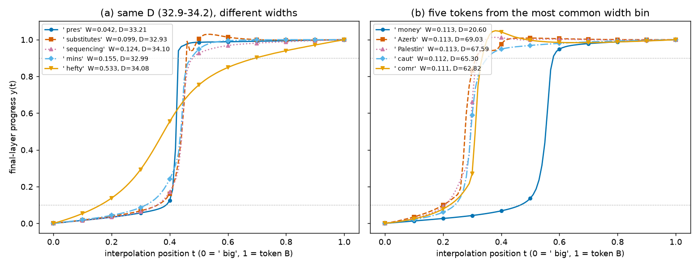

**Figure 4.** GPT-2 Large, final-block y(t). x: interpolation position t; y: y(t). Dotted lines mark
0.1 and 0.9. Each token has its own line style and marker. (a) Five lowercase words with D within 2% of
the median (32.9–34.2), nearest the minimum, 25th, 50th, 75th percentile and maximum of W_final among
the 3,859 tokens in that band: ` pres` (0.042), ` substitutes` (0.099), ` sequencing` (0.124),
` mins` (0.155), ` hefty` (0.533). (b) Five tokens from the most common width bin (0.111–0.114):
` money`, ` Azerb`, ` Palestin`, ` caut`, ` comr`.

The band's own extremes are 0.036 and 0.589; the words shown are the nearest lowercase words to those
values. In panel (b), ` money` (D 20.6) was taken from the fixed word list used in the embedding run;
the other four are the highest-D tokens in the bin (D 62.8–69.0), chosen by the script's fill rule.
` substitutes` and ` comr` overshoot y = 1 briefly.

## R5 — Other models

### GPT2-XL

To check for a slope in GPT2-XL, Figure 6 plots every token and Figure 7 zooms in on the 5th–95th
percentile of D (28.64–54.91).

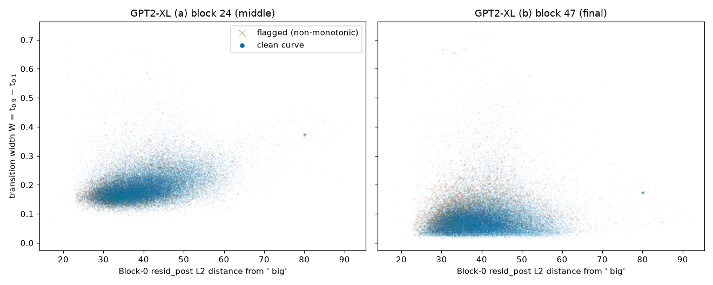

**Figure 6.** GPT2-XL. Each point is one token B. x: block-0 resid_post L2 distance D from ` big`;
y: transition width W. (a) block 24 (middle); (b) block 47 (final). Round dots = unflagged curves;
crosses = flagged curves.

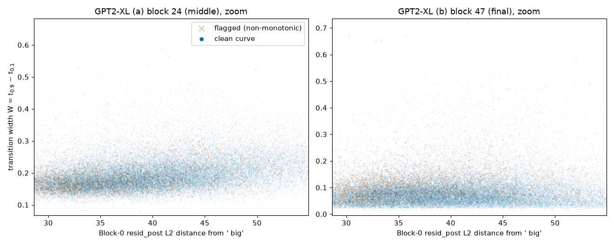

**Figure 7.** GPT2-XL, zoom of Figure 6. x: D limited to its 5th–95th percentile; y: W limited to the
smallest-to-largest W in that range (middle: 0.080–0.671; final: 0.010–0.721).
Same panels and markers as Figure 6.

To check for separate groups of final-block widths, Figure 8 shows their histogram and sorted values.

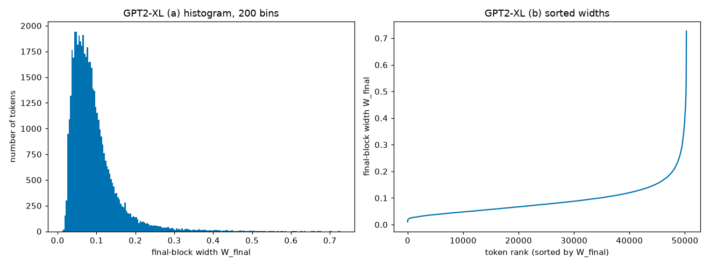

**Figure 8.** GPT2-XL. (a) Histogram of W_final (200 bins); x: W_final, y: number of tokens. (b) The same
widths sorted; x: token rank, y: W_final.

The most common bin is W_final 0.043–0.046; the 90th and 99th percentiles are 0.157 and 0.343;
B = ` large` has W_final 0.545. The table lists, for each W_final band, the tokens with the lowest D.
These are examples only and do not describe the whole band.

| W_final band | tokens | lowest-D examples |
|---|---|---|
| 0.00–0.05 | 11,285 | ` a`, ` all`, ` getting`, ` "`, ` that`, `That` |
| 0.05–0.10 | 23,290 | ` Big`, ` the`, `\n`, ` up`, ` much`, ` your` |
| 0.10–0.15 | 9,990 | `Big`, ` good`, ` lot`, ` you`, ` really`, ` many` |
| 0.15–0.20 | 3,193 | `big`, ` great`, ` long`, ` like`, ` high`, ` real` |
| 0.20–0.30 | 1,746 | ` major`, ` little`, ` new`, ` same`, ` old`, ` strong` |
| 0.30–0.50 | 680 | ` bigger`, ` small`, ` size`, ` young`, ` better`, ` larger` |
| 0.50–1.00 | 72 | ` huge`, ` biggest`, ` large`, ` largest`, ` giant`, `small` |

The 12 widest tokens (W_final in brackets): ` giant` (0.73), `UGE` (0.72), ` fatty` (0.70), `arger` (0.70), ` myriad` (0.68), ` tremendous` (0.67), `tiny` (0.67), `huge` (0.67), ` vast` (0.66), `massive` (0.66), ` Huge` (0.65), ` monstrous` (0.64).

### Pythia 1.4B

To check for a slope in Pythia 1.4B, Figure 9 plots every token and Figure 10 zooms in on the 5th–95th
percentile of D (24.46–36.52).

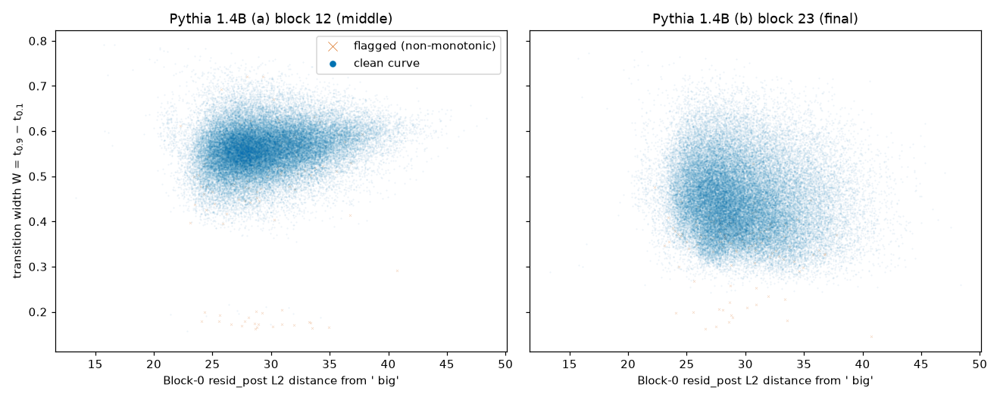

**Figure 9.** Pythia 1.4B. Each point is one token B. x: block-0 resid_post L2 distance D from ` big`;
y: transition width W. (a) block 12 (middle); (b) block 23 (final). Round dots = unflagged curves;
crosses = flagged curves.

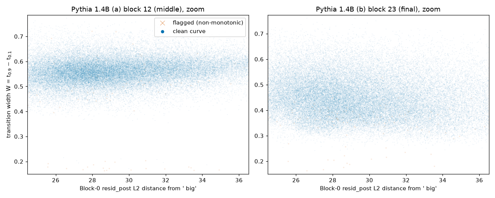

**Figure 10.** Pythia 1.4B, zoom of Figure 9. x: D limited to its 5th–95th percentile; y: W limited to the
smallest-to-largest W in that range (middle: 0.163–0.773; final: 0.162–0.761).
Same panels and markers as Figure 9.

To check for separate groups of final-block widths, Figure 11 shows their histogram and sorted values.

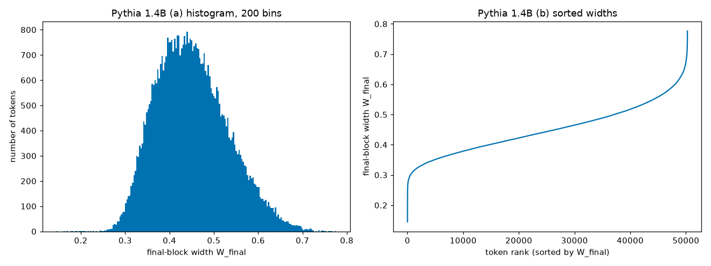

**Figure 11.** Pythia 1.4B. (a) Histogram of W_final (200 bins); x: W_final, y: number of tokens. (b) The same
widths sorted; x: token rank, y: W_final.

The most common bin is W_final 0.439–0.442; the 90th and 99th percentiles are 0.561 and 0.654;
B = ` large` has W_final 0.774. The table lists, for each W_final band, the tokens with the lowest D.
These are examples only and do not describe the whole band.

| W_final band | tokens | lowest-D examples |
|---|---|---|
| 0.00–0.05 | 0 |  |
| 0.05–0.10 | 0 |  |
| 0.10–0.15 | 1 | `<¦endoftext¦>` |
| 0.15–0.20 | 8 | `\r\n`, `\n\t`, `\n\t\t`, `\n\t\t\t`, `\r\n\t\t`, `\n\t\t\t\t` |
| 0.20–0.30 | 516 | ` Big`, `Big`, `\n`, `."`, ` They`, ` Our` |
| 0.30–0.50 | 36,544 | ` BIG`, `big`, `Large`, ` Large`, `large`, ` \n    ` |
| 0.50–1.00 | 13,207 | ` huge`, ` bigger`, ` large`, ` biggest`, ` larger`, `\n                                                  ` |

The 12 widest tokens (W_final in brackets): ` giant` (0.78), ` large` (0.77), ` vast` (0.76), ` huge` (0.76), ` monstrous` (0.76), `cule` (0.76), ` gigantic` (0.76), ` tremendous` (0.75), ` intimate` (0.75), `izable` (0.75), `sized` (0.75), ` massive` (0.75).

### Llama-3.1-8B

To check for a slope in Llama-3.1-8B, Figure 12 plots the tokens with D between 1 and 2.5 and Figure 13
zooms in on the 5th–95th percentile of D (1.56–1.90).

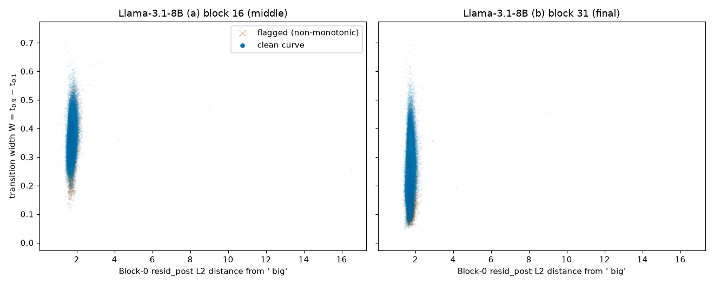

**Figure 12.** Llama-3.1-8B. Each point is one token B. x: block-0 resid_post L2 distance D from ` big`;
y: transition width W. (a) block 16 (middle); (b) block 31 (final). Round dots = unflagged curves;
crosses = flagged curves. The x-axis is limited to D from 1 to 2.5; 26 of 128,255 tokens fall outside it
and are not drawn (3 below 1; 23 above 2.5, the farthest at D ≈ 16.5).

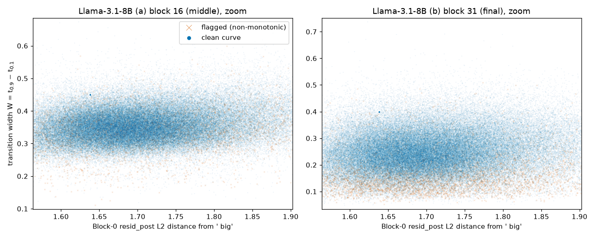

**Figure 13.** Llama-3.1-8B, zoom of Figure 12. x: D limited to its 5th–95th percentile; y: W limited to the
smallest-to-largest W in that range (middle: 0.110–0.674; final: 0.048–0.738).
Same panels and markers as Figure 12.

To check for separate groups of final-block widths, Figure 14 shows their histogram and sorted values.

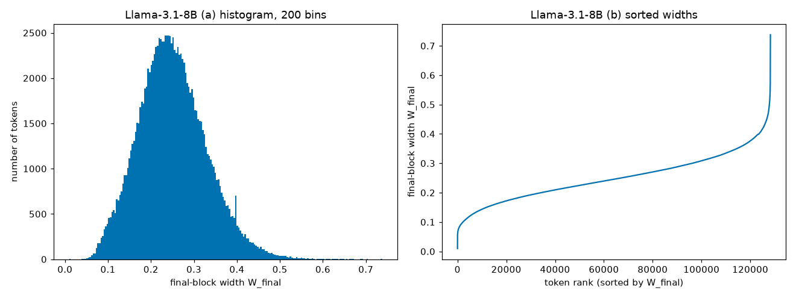

**Figure 14.** Llama-3.1-8B. (a) Histogram of W_final (200 bins); x: W_final, y: number of tokens. (b) The same
widths sorted; x: token rank, y: W_final.

The most common bin is W_final 0.239–0.243; the 90th and 99th percentiles are 0.354 and 0.456;
B = ` large` has W_final 0.702. The table lists, for each W_final band, the tokens with the lowest D.
These are examples only and do not describe the whole band.

| W_final band | tokens | lowest-D examples |
|---|---|---|
| 0.00–0.05 | 8 | ` .\n`, `\n\n`, `;\n`, `;\n\n`, ` ...\n`, `:\n\n` |
| 0.05–0.10 | 2,211 | ` Big`, `.Big`, `\n`, `大`, `,\n`, `:\n` |
| 0.10–0.15 | 9,653 | `Big`, `big`, `_big`, `.`, `,`, ` ` |
| 0.15–0.20 | 22,413 | `.big`, `(big`, ` in`, ` on`, ` and`, `dıktan` |
| 0.20–0.30 | 61,906 | ` BIG`, `BIG`, ` biggest`, `/big`, `kyně`, ` high` |
| 0.30–0.50 | 31,646 | `-big`, ` bigger`, ` small`, ` Large`, ` long`, ` good` |
| 0.50–1.00 | 418 | ` large`, ` huge`, ` larger`, ` giant`, ` massive`, ` size` |

The 12 widest tokens (W_final in brackets): ` oversized` (0.74), ` large` (0.70), ` malicious` (0.69), ` prestigious` (0.69), ` limitless` (0.69), ` extensive` (0.67), ` sprawling` (0.67), ` tremendous` (0.66), ` alertController` (0.66), ` huge` (0.65), ` cleanly` (0.65), ` substantial` (0.64).

### Qwen3-8B-Base

To check for a slope in Qwen3-8B-Base, Figure 15 plots the tokens with D between 10 and 55 and Figure 16
zooms in on the 5th–95th percentile of D (16.41–32.30).

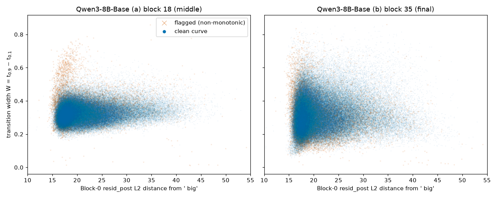

**Figure 15.** Qwen3-8B-Base. Each point is one token B. x: block-0 resid_post L2 distance D from ` big`;
y: transition width W. (a) block 18 (middle); (b) block 35 (final). Round dots = unflagged curves;
crosses = flagged curves. The x-axis is limited to D from 10 to 55; 20 of 151,668 tokens fall outside it
and are not drawn (4 below 10; 16 above 55, the farthest at D ≈ 103).

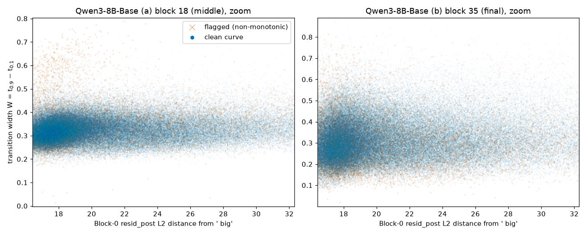

**Figure 16.** Qwen3-8B-Base, zoom of Figure 15. x: D limited to its 5th–95th percentile; y: W limited to the
smallest-to-largest W in that range (middle: 0.014–0.788; final: 0.018–0.874).
Same panels and markers as Figure 15.

To check for separate groups of final-block widths, Figure 17 shows their histogram and sorted values.

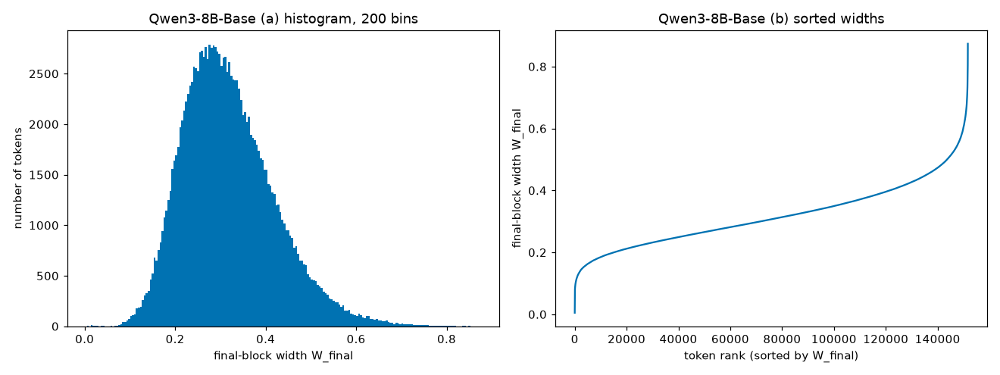

**Figure 17.** Qwen3-8B-Base. (a) Histogram of W_final (200 bins); x: W_final, y: number of tokens. (b) The same
widths sorted; x: token rank, y: W_final.

The most common bin is W_final 0.274–0.279; the 90th and 99th percentiles are 0.454 and 0.610;
B = ` large` has W_final 0.672. The table lists, for each W_final band, the tokens with the lowest D.
These are examples only and do not describe the whole band.

| W_final band | tokens | lowest-D examples |
|---|---|---|
| 0.00–0.05 | 30 | ` zwłas`, `�`, `깞`, `𡐓`, `섁`, `귱` |
| 0.05–0.10 | 277 | `b`, ` G`, `G`, ` t`, ` p`, `_b` |
| 0.10–0.15 | 2,787 | `BIG`, ` BIG`, ` g`, ` b`, `g`, ` d` |
| 0.15–0.20 | 12,043 | ` Big`, `_big`, ` dig`, `퓭`, `d`, `2` |
| 0.20–0.30 | 56,563 | `big`, `Big`, `-big`, `(big`, `_BIG`, ` bad` |
| 0.30–0.50 | 71,949 | `.Big`, `.big`, `/big`, ` bigger`, `ig`, `퀅` |
| 0.50–1.00 | 8,019 | `굠`, `ו�`, `หัวข้อ`, ` bold`, `𖥨`, `ﱅ` |

The 12 widest tokens (W_final in brackets): `ซู` (0.87), `�` (0.86), ` valueType` (0.85), ` backpage` (0.85), ` nightlife` (0.85), ` kneeling` (0.84), ` ToolStrip` (0.84), `发展机遇` (0.84), `ชั่วโมง` (0.84), `นะครับ` (0.83), `햍` (0.83), `שׂ` (0.83).

## R6 — Interpolation-path control (GPT-2 Large pilot)

**Question.** The main run slides the block-0 vector along a straight line. Matthew's experiments use a
curved path. Does the relationship between distance and transition width in GPT-2 Large depend on which
path is injected? This is a pilot on 256 token pairs in one model. It changes the path only; the hook,
readouts, width rule and flag are those of the main run.

**The two paths.** Both start at r_A and end at r_B, the same unpatched block-0 vectors as in the main run.
The linear path is the main run's r(t) = (1 − t)·r_A + t·r_B. Matthew's path is the function
`slerp_rescale` from `scripts/utils.py` of `MShinkle/activation_plateau_mechanisms` (repository commit
`4222c3e`; last change to the file `9e844be`, 2025-10-03). It turns the direction of the vector at a steady
angular rate from the direction of r_A to that of r_B, and sets the vector's length to the straight-line
mix of the two lengths. With unit directions u_A, u_B and lengths n_A, n_B:

```math
\theta = \arccos\lvert u_A \cdot u_B \rvert, \qquad
r_M(t) = \big((1-t)\,n_A + t\,n_B\big)\,\frac{\sin((1-t)\theta)\,u_A + \sin(t\theta)\,u_B}{\sin\theta}
```

The absolute value inside the arccos is in the published code and is kept. It matters only when the
cosine between r_A and r_B is negative; in that case the path would not keep the stated length. No pair in
this pilot has a negative cosine (range 0.13–0.80), so for these pairs the function equals ordinary
spherical interpolation with length rescaling. Our batched port (`experiments/path_control.py`) was
compared with a verbatim copy of the reference (`experiments/matthew_reference_utils.py`) on 64 random
vector pairs with cosines from −0.95 to 0.95 and on 26 real endpoint pairs: the largest relative difference
is 8 in 10 million. No epsilon or other numerical repair was added, and no value was non-finite.

**Pairs.** 256 partner token IDs were drawn without replacement with seed 0 from the sweep's vocabulary
(every ID except ` big`), before any run of the new path
(`results/block0_resid_post/path_control/pairs.json`). Six pairs already shown in REPORT.md (` pres`,
` hefty`, ` large`, ` huge`, ` whopping`, ` money`) were added for illustration only; they are in no
summary number below. Both paths were run on the same pairs. The saved full-vocabulary sweep keeps only
normalized curves, so the linear path was rerun on this subset to store the distances needed for the second
normalization. The rerun reproduces the saved sweep: D is identical and W differs by less than 1 in a
million.

**Checks.** For both paths and all 262 pairs: the vector entering block 1 at the last position equals the
injected path exactly; earlier positions differ from the unpatched ` big` run by at most 1.3e-5 (float32
noise from the batch size); the injected endpoints match r_A and r_B to 5 in 100 million; and the raw
readout vectors at t = 0 and t = 1 match separate unpatched runs of A and B to 2 in a million
(`validation.json`, `pilot_checks.json`).

**Two distances.** D_endpoint is the L2 distance between r_A and r_B, the D of the main run; it is the
same for both paths. L_path is the length of the path that is actually injected, summed over a fine grid
of 2,000 steps (doubling the grid from 1,000 steps changes it by 1 in 10 million):

```math
L_{path} = \sum_i \lVert r(t_{i+1}) - r(t_i) \rVert_2
```

For the linear path L_path equals D_endpoint. Matthew's path is longer by 3.7% to 15.6% (median 7.5%) over
the 256 pairs. Its length at each t equals the straight-line mix of the endpoint lengths to 2 in 10
million; the linear path's length dips to as little as 75% of that mix.

**Two normalizations.** The primary comparison uses the main run's progress y(t) for both paths
(distance moved from the t = 0 readout, divided by the distance between the t = 0 and t = 1 readouts).
The secondary comparison recomputes, from the same forward passes, the measure used in Matthew's work,
which divides by the sum of the distances to both ends, with x(t) the readout:

```math
y_{rel}(t) = \frac{\lVert x(t) - x(0) \rVert_2}{\lVert x(t) - x(0) \rVert_2 + \lVert x(t) - x(1) \rVert_2}
```

The two agree when the readout moves along a straight line and differ when its route bends. W and the
flag are computed from either curve by the same rule. No denominator was zero, so all 256 pairs are valid
under both paths and both normalizations.

**Counts and exclusions.** With the main normalization, 11 of 256 pairs are flagged under the linear path
and 5 under Matthew's path (the same 5 are among the 11). Paired numbers use the 245 pairs unflagged under
both. With the relative normalization no pair is flagged, and all 256 are used. All rows, with flags, are
in `pilot_widths.csv`.

### Distance versus width under each path

To see whether the trend with distance survives the change of path, we group the pairs into fifths by
D_endpoint and take the median width per fifth for each path.

| normalization, block | path | nearest fifth | 2nd | 3rd | 4th | farthest fifth |
|---|---|---|---|---|---|---|
| main, middle (block 18) | linear | 0.197 | 0.198 | 0.207 | 0.233 | 0.259 |
| main, middle | Matthew's | 0.189 | 0.203 | 0.217 | 0.255 | 0.282 |
| main, final (block 35) | linear | 0.114 | 0.105 | 0.117 | 0.143 | 0.136 |
| main, final | Matthew's | 0.113 | 0.116 | 0.133 | 0.164 | 0.163 |
| relative, middle | linear | 0.356 | 0.381 | 0.445 | 0.468 | 0.507 |
| relative, middle | Matthew's | 0.329 | 0.346 | 0.391 | 0.411 | 0.431 |
| relative, final | linear | 0.280 | 0.276 | 0.345 | 0.368 | 0.421 |
| relative, final | Matthew's | 0.264 | 0.268 | 0.317 | 0.344 | 0.367 |

**Table 1.** GPT-2 Large pilot. Median W by fifth of D_endpoint (edges 28.8, 31.9, 35.3, 38.9). Main
normalization: 245 pairs unflagged under both paths, 48–50 per fifth. Relative normalization: 256 pairs,
51–52 per fifth.

At the middle block with the main normalization, both paths rise with distance: 0.197 to 0.259 for the
linear path and 0.189 to 0.282 for Matthew's. The linear row agrees with the full-vocabulary medians of R3
(0.196 to 0.276). At the final block the linear path rises by 0.02, as in R3, and Matthew's path by 0.05.
Grouping Matthew's widths by L_path gives almost the same medians as grouping by D_endpoint (middle
0.190, 0.202, 0.217, 0.255, 0.282; final 0.114, 0.113, 0.133, 0.164, 0.163), because L_path stays
within 4–16% of D_endpoint. Figure 18 shows the individual pairs.

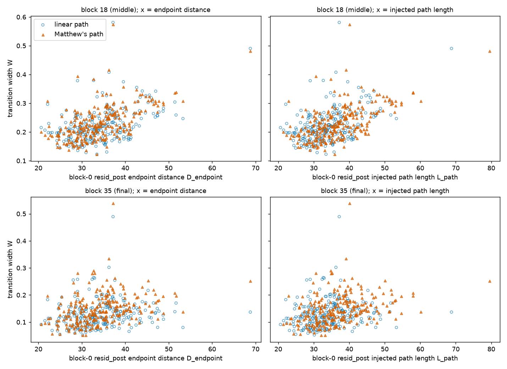

**Figure 18.** GPT-2 Large pilot, main normalization, 245 pairs unflagged under both paths. Rows: middle
block (top), final block (bottom). Left column x: D_endpoint; right column x: L_path. y: transition width W.
Open circles: linear path; filled triangles: Matthew's path. In the left column the two markers of a pair
share the same x.

### Paired comparison of the two paths

To see how much the path changes the width of a single pair, we plot one path's width against the other's.

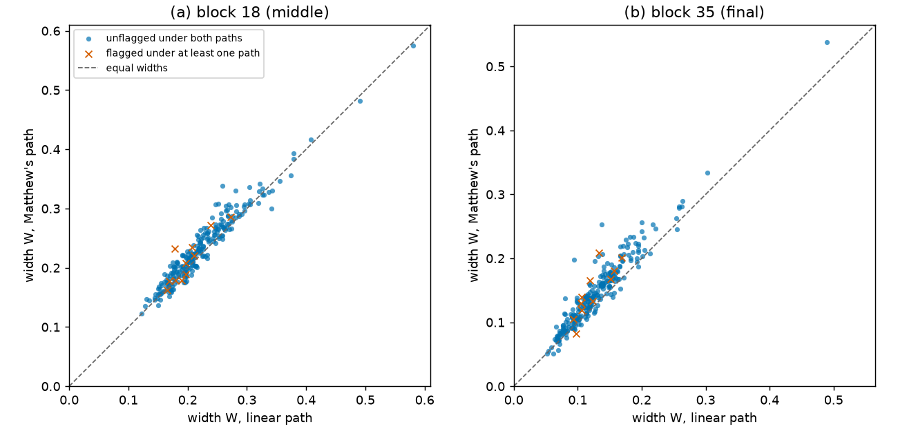

**Figure 19.** GPT-2 Large pilot, main normalization, 256 random pairs. x: W under the linear path; y: W
under Matthew's path. (a) middle block, (b) final block. Dots: unflagged under both paths (245); crosses:
flagged under at least one (11). Dashed line: equal widths.

The pairs lie close to the line of equal widths, slightly above it. Among the 245 unflagged pairs,
Matthew's path gives the wider curve in 180 at the middle block (median difference +0.009) and in 218 at
the final block (median difference +0.016). The difference exceeds 0.05 in 3 pairs at the middle block and
10 at the final block; the largest is +0.115. The ordering of pairs by width is largely kept.

### Matched curves

To show what the two paths do to single curves, Figure 20 overlays them for the six illustrative pairs.
It also draws the progress of Matthew's injected path itself, computed like y but on the injected vector:
‖r_M(t) − r_A‖ / ‖r_B − r_A‖. A curved input path can by itself bend a progress curve, so this line shows
how much bending comes from the input.

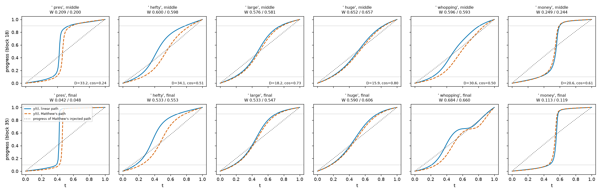

**Figure 20.** GPT-2 Large, six illustrative pairs (not part of the random sample). x: interpolation
position t; y: progress with the main normalization. Top row: middle block; bottom row: final block. Solid:
linear path; dashed: Matthew's path; dotted: progress of Matthew's injected path. Thin horizontal lines mark
0.1 and 0.9. Titles give W as linear / Matthew's; the top panels give D_endpoint and the cosine between r_A
and r_B.

The injected-path progress stays near the diagonal: over the 256 random pairs it departs from t by at most
0.043 (median of the per-pair maximum 0.015). The readout curves keep their shape under both paths. Sharp
jumps stay sharp (` pres`: W_final 0.042 and 0.048; ` money`: 0.113 and 0.119) and gradual curves stay
gradual (` hefty`: 0.533 and 0.553; ` huge`: 0.590 and 0.606; ` whopping`: 0.684 and 0.660). Under
Matthew's path the switch of ` pres`, ` hefty` and ` whopping` happens at a later t.

### Offline normalization comparison

This comparison changes the normalization and uses no new forward passes. It is kept separate from the
path comparison above.

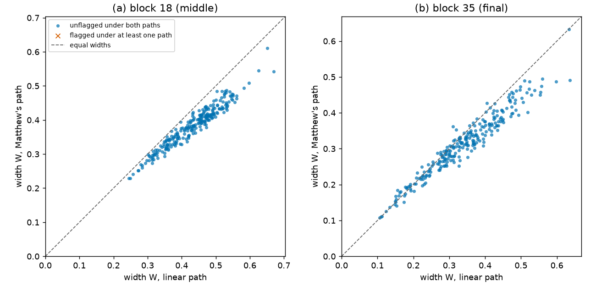

**Figure 21.** GPT-2 Large pilot, relative normalization, 256 random pairs (none flagged). x: W under the
linear path; y: W under Matthew's path. (a) middle block, (b) final block. Dashed line: equal widths.

The relative normalization gives much larger widths than the main one for the same forward passes: the
median W under the linear path is 0.436 at the middle block and 0.341 at the final block, against 0.210
and 0.120. Under it, Matthew's path gives the narrower curve in all 256 pairs at the middle block (median
difference −0.047) and in 205 of 256 at the final block (median −0.022), the opposite direction from the
main normalization. Figure 22 and Table 1 show that width rises with distance under both paths and at
both blocks: by 0.10–0.15 from the nearest to the farthest fifth.

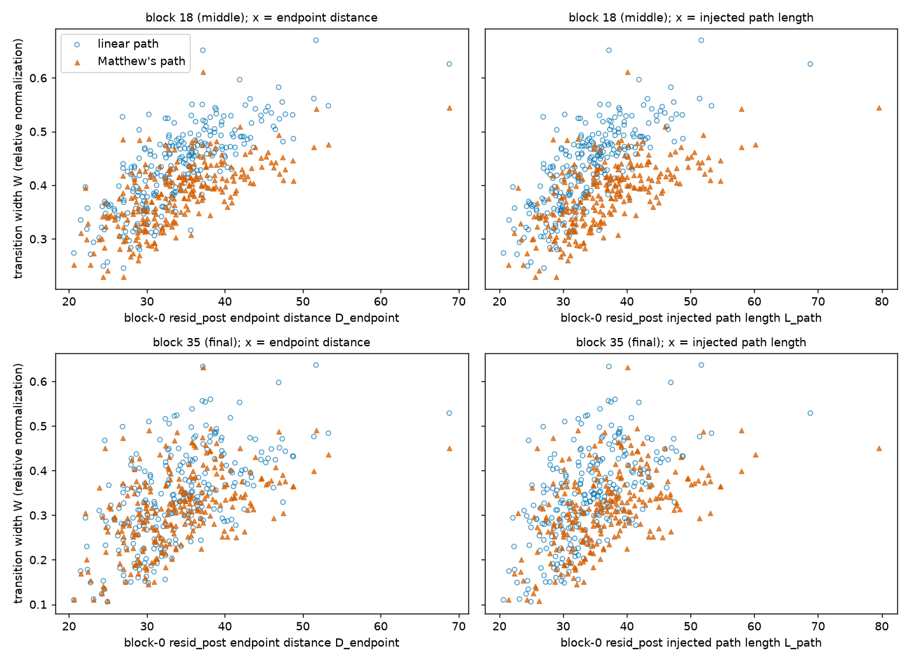

**Figure 22.** As Figure 18, with W computed from the relative normalization; 256 pairs.

### What the pilot shows

- The middle-block reading of the main run does not depend on the path: width rises with distance under
  both (Table 1, Figure 18), and endpoint distance and path length give the same grouping.
- Single-pair widths change little with the path under the main normalization (Figure 19).
- The final-block reading is less stable. The rise from nearest to farthest fifth is 0.02 with the linear
  path and main normalization, 0.05 with Matthew's path, and 0.10–0.14 with the relative normalization
  under either path (Table 1). The choice of normalization moves this number more than the choice of path.
- Coverage: one model, 256 random pairs, about 50 per fifth, no statistical test. The other four models
  and the full vocabulary were not run with Matthew's path.

## R7 — SLERP path, full vocabulary, five models

Every model's full sweep was rerun with Matthew's `slerp_rescale` path (SLERP) in place of the straight
line; everything else is unchanged (`experiments/slerp_sweep.py`). Data: `results/block0_resid_post/slerp/<model>.csv`
(one row per token: D, SLERP path length L_slerp summed over the 100 injected steps, endpoint cosine,
W_mid, W_final, the combined flag, and `mono_final`, the final-block-only monotonic test). Summary
numbers: `results/block0_resid_post/slerp/summary.json`; figures from
`experiments/summary_slerp_distance_vs_width.py` (five-panel summaries, Figures 23–24) and
`experiments/slerp_fig1_per_model.py` (per-model middle/final scatters,
`plots/block0_resid_post/slerp/<model>_fig1_slerp_distance_vs_width.png`; these are REPORT.md Figures 9–13).

**Checks.** No SLERP path was non-finite in any model. The largest relative L2 gap between the injected
vector and r_A at t = 0 / r_B at t = 1 was 1.1e-8 / 6.5e-8 (Pythia), 2.9e-8 / 6.2e-8 (Llama) and
3.1e-9 / 5.9e-8 (Qwen3). The same check ran for the GPT-2 Large and GPT2-XL sweeps, but its log was on a
scratch disk that was wiped; their CSVs are complete (50,256 rows, no missing values). Tokens with a
negative endpoint cosine: GPT-2 Large 0, GPT2-XL 77, Pythia 0, Llama 4, Qwen3 5 (lowest −0.066). For
these the absolute value in Matthew's θ makes the path depart from a true spherical arc; the endpoints
are still exact. L_slerp / D: GPT-2 Large 1.013–1.176 (median 1.075), GPT2-XL 1.016–1.180 (1.068),
Pythia 1.009–1.104 (1.047), Llama 1.016–1.273 (1.088), Qwen3 1.009–1.241 (1.073). Pearson r between
L_slerp and D is 0.9995–0.9996 in the GPT-2 models, Pythia and Qwen3, and 0.9956 in Llama.

The table compares the final-block relationship under the two paths with the same filter
(final-block curve monotonic). Straight-line values use D; SLERP values use L_slerp and, in the last
column, D.

| Model | n straight | n SLERP | Pearson r straight | Pearson r SLERP | ρ straight | ρ SLERP (L_slerp) | ρ SLERP (D) |
|---|---|---|---|---|---|---|---|
| GPT-2 Large | 49,244 | 49,712 | +0.127 | +0.296 | +0.148 | +0.326 | +0.330 |
| GPT2-XL | 45,954 | 46,857 | +0.054 | +0.084 | +0.054 | +0.100 | +0.101 |
| Pythia 1.4B | 50,155 | 50,239 | −0.138 | +0.038 | −0.149 | +0.023 | +0.021 |
| Llama-3.1-8B | 122,528 | 123,060 | +0.149 | +0.211 | +0.149 | +0.208 | +0.194 |
| Qwen3-8B-Base | 132,653 | 139,182 | +0.061 | +0.354 | +0.088 | +0.354 | +0.353 |

**Table R7.** Final-block width against distance, straight line vs SLERP, full vocabularies.

Median W_final under SLERP by fifth of L_slerp (nearest to farthest): GPT-2 Large 0.115, 0.129, 0.139,
0.150, 0.162; GPT2-XL 0.077, 0.089, 0.090, 0.092, 0.087; Pythia 0.467, 0.457, 0.458, 0.460, 0.473;
Llama 0.289, 0.307, 0.310, 0.324, 0.351; Qwen3 0.371, 0.404, 0.425, 0.442, 0.500. Share of all tokens
with W_final < W_mid under SLERP: GPT-2 Large 98.0%, GPT2-XL 97.1%, Pythia 94.1%, Llama 92.5%, Qwen3
42.6% (59.7% under the straight line).

Median W_mid under SLERP by fifth of L_slerp, all tokens (nearest to farthest): GPT-2 Large 0.192, 0.205,
0.222, 0.247, 0.294; GPT2-XL 0.170, 0.182, 0.198, 0.217, 0.251; Pythia 0.555, 0.564, 0.570, 0.581, 0.599;
Llama 0.404, 0.418, 0.418, 0.425, 0.450; Qwen3 0.370, 0.386, 0.402, 0.416, 0.472. Spearman ρ of W_mid
with L_slerp, all tokens: +0.59, +0.53, +0.32, +0.25, +0.47.

Figure 23 summarizes the final block of REPORT.md Figures 9–13 in one figure, with a Spearman panel.

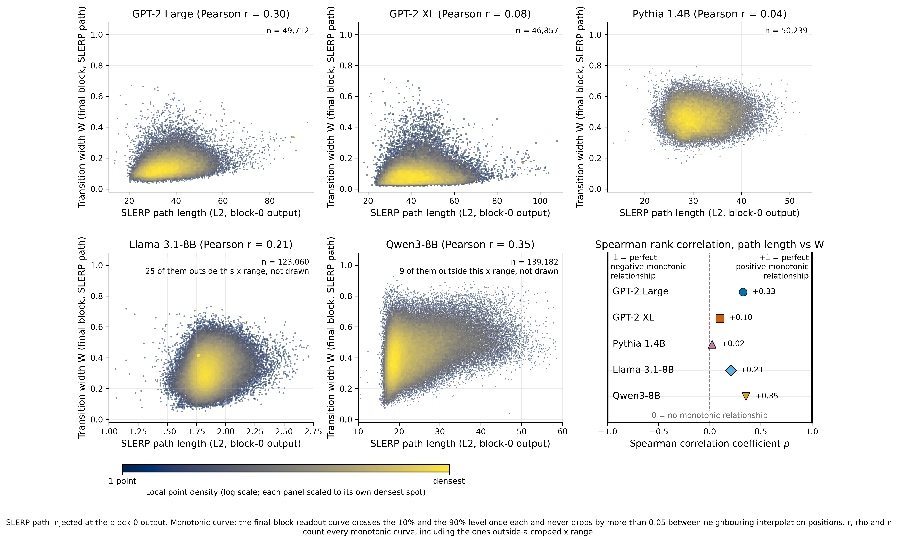

**Figure 23.** Panels 1–5: final-block W under SLERP (y) against SLERP path length L_slerp (x, L2,
block-0 output), tokens with a monotonic final-block curve; colour is local point density (log scale).
Llama is shown for L_slerp 1.0–2.75 (25 tokens not drawn) and Qwen3 for 10–60 (9 not drawn), the
ranges of REPORT.md Figures 12–13. Last panel: Spearman ρ per model.

To check that the x-axis choice does not drive the result, Figure 24 repeats it with endpoint distance D.

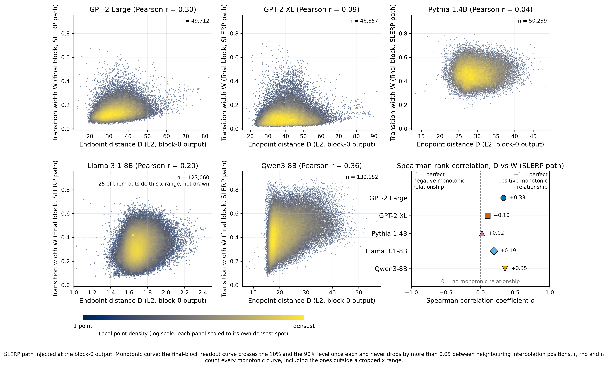

**Figure 24.** As Figure 23, with x = endpoint distance D (L2, block-0 output). Llama is shown for
D 1.0–2.5 (25 tokens not drawn) and Qwen3 for D 10–55 (5 not drawn); no other panel is cropped.

## Headline

With interpolation and distance both at the output of block 0, the middle-block width rises with
distance in GPT-2 Large and GPT2-XL by an amount comparable to the spread among tokens at one distance.
Pythia 1.4B, Llama-3.1-8B and Qwen3-8B-Base show a smaller rise. Final-block width shows no shared
direction across models. At any one distance, widths still range from very sharp to very gradual, and
the widest GPT-2 Large switches again belong to size words and rare strings. In a 256-pair GPT-2 Large
pilot, replacing the straight-line path with Matthew's curved path leaves the middle-block trend in place
and changes single-pair widths little; the final-block trend is larger under his path and larger again
under his normalization (R6). Over full vocabularies under SLERP, the middle-block rise holds in all five
models; the final-block Spearman ρ is higher than under the straight line in all five, but a positive link
appears only in GPT-2 Large, Qwen3 and Llama (+0.21 to +0.35), with GPT2-XL (+0.10) and Pythia (+0.02)
near zero (R7). These are associations
across tokens for one prompt; no cause was tested.
