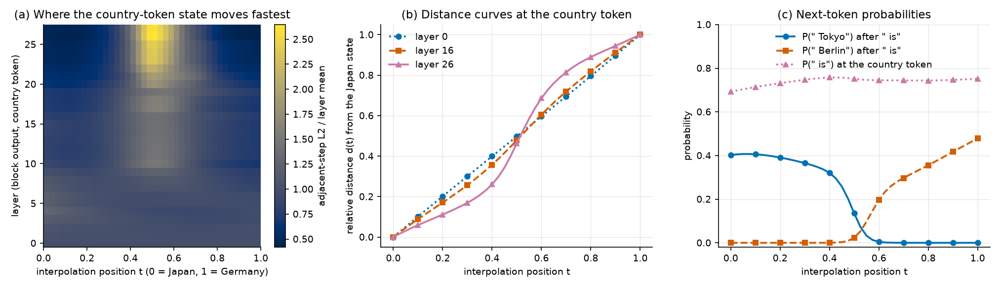
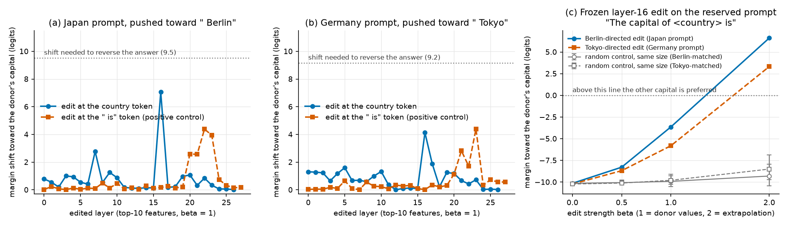
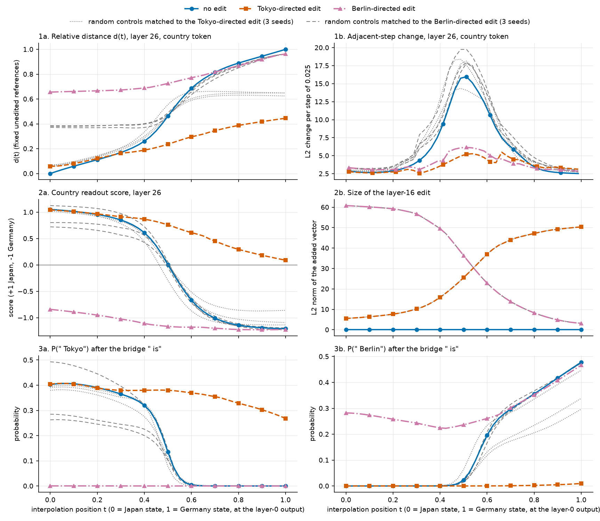
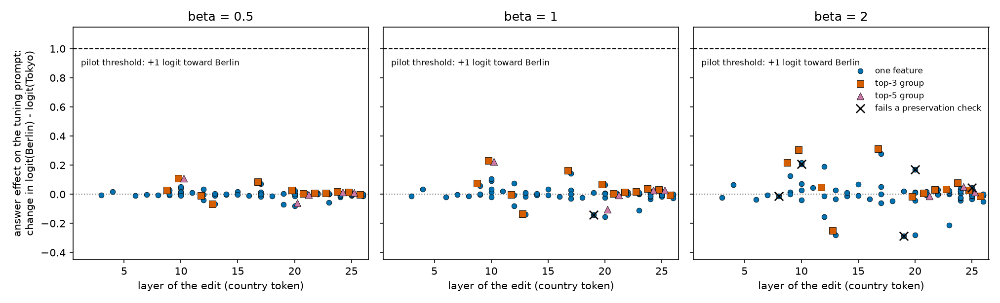
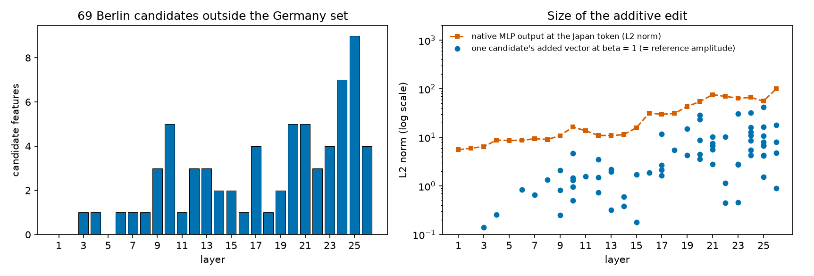
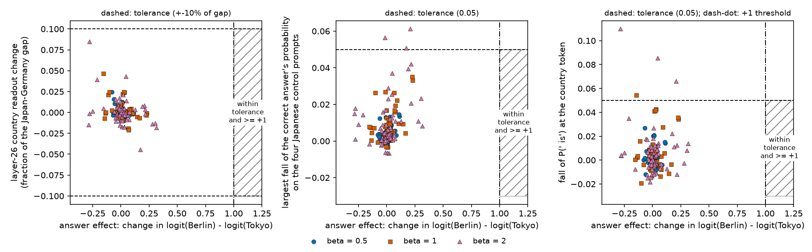
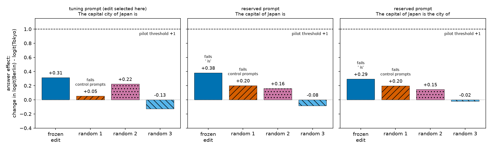

# RESULTS — Does the Japan-to-Germany plateau follow country identity or the later answer? (Qwen3-0.6B)

Detailed evidence record for this direction. `REPORT.md` is the short synthesis. All numbers come from
`results/` and can be regenerated with `bash experiments/run_all.sh`. Section 5 is a separate addendum; its
numbers come from `results/additive/` and `bash experiments/run_additive.sh`.

## Headline

We could not separate the two explanations. No edit of transcoder features at the country word reversed the
capital answer at natural strength. The only edit that did (layer 16, 10 features, twice the natural strength)
also changed the country itself: the country readout flipped and the model's currency and language answers
switched to the other country. Under this edit the answer boundary, the readout crossing and most of the
late-layer plateau boundary disappear together, so the plan's verdict is **not disentangled**.

**Addendum (Section 5).** A follow-up asked whether a purely additive edit at the country token can promote
the Berlin answer while Japan-related information is preserved. We screened 69 candidate features from the
earlier feature study, alone and in within-layer groups, at strengths up to 2 on the tuning prompt (256
settings). The largest shift toward Berlin is 0.314 logits against the 1.0 required; it passes all three
preservation checks, as do 250 of the 256 settings. That setting was frozen and run once on the two reserved
prompts with three matched random controls. It moves the answer by +0.381 and +0.293 logits, more than every
control (at most +0.201) and far below +1, and it fails one preservation check there (P(` is`) falls by
0.095). The pilot does not pass, so the path was not rerun. No selective additive intervention found in this
bounded candidate search.

## Terms used below

- **Country token**: the token ` Japan` or ` Germany` in the prompt. **Bridge**: the text ` is` (or
  ` is the city of`) that we append after the country token so the model has to name the capital next.
- **State**: the residual-stream vector at one token after one of the 28 transformer blocks (width 1024).
- **Path**: 41 states at the layer-0 block output of the country token, from the Japan state (`t = 0`) to
  the Germany state (`t = 1`), by spherical interpolation of direction and linear interpolation of length.
  Everything downstream is recomputed for each `t`.
- **Adjacent-step change**: L2 distance between the states at two neighbouring `t` values, at a given layer.
  **Peak / mean** is its largest value divided by its mean over the 40 steps (1.0 for a path that moves at
  constant speed). **Boundary** is the `t` where the adjacent-step change is largest.
- **Relative distance `d(t)`**: distance to the unedited `t = 0` state divided by the sum of the distances to
  the unedited `t = 0` and `t = 1` states. **Width 10–90** is the range of `t` over which `d` goes from 0.1 to
  0.9 (0.8 for a straight path).
- **Margin**: logit of ` Tokyo` minus logit of ` Berlin` at the last bridge token. Positive means Tokyo is
  preferred. **Answer boundary** is the `t` where the margin crosses zero.
- **Country readout**: a linear score fitted on 32 non-capital prompts (16 per country); +1 is the mean Japan
  state and −1 the mean Germany state. It is fitted separately per layer and never sees capital prompts or
  edited states.
- **Feature**: one unit of a transcoder, a sparse dictionary that imitates one MLP block. **Decoder
  direction**: the vector that a feature adds to the MLP output.
- **Edit**: `MLP_new = MLP_native + beta * sum_i (a_donor_i − a_current_i) * decoder_i` at one layer and token.
  `a_current` is the feature's value in the run being edited and `a_donor` its stored value in the other
  country's tuning prompt. `beta = 1` replaces the features by the donor's values; `beta = 2` goes twice as
  far and is labelled extrapolation.
- **Random control**: the same coefficients placed on 10 random decoder directions of the same dictionary and
  rescaled to the real edit's L2 norm (3 seeds).
- **Greedy continuation**: the text the model writes after a prompt when it always takes its most likely next
  token, with no sampling (8 new tokens in every table of this file).

Section 5 uses a different edit and a few more terms (additive edit, reference amplitude, candidate,
preservation checks); they are defined in Section 5.1.

## 1. Baseline: prompts, plateau and readout

All six capital prompts are answered correctly, and ` Japan`, ` Germany`, ` is`, ` Tokyo`, ` Berlin` are single
tokens. The table lists the unedited behaviour. "P(` is`)" is read at the country token; the other columns are
read after the bridge.

| Prompt | Role | P(` is`) | Top token | Its probability | Margin | Greedy continuation |
|---|---|---:|---|---:|---:|---|
| `The capital city of Japan is` | tuning | 0.409 | `Tokyo` | 0.183 | +9.53 | `Tokyo. The capital city of China is` |
| `The capital city of Germany is` | tuning | 0.601 | `Berlin` | 0.252 | −9.17 | `Berlin. The capital city of France is` |
| `The capital of Japan is` | reserved (original) | 0.693 | `Tokyo` | 0.402 | +10.15 | `Tokyo. The capital of the United States` |
| `The capital of Germany is` | reserved (original) | 0.751 | `Berlin` | 0.477 | −10.23 | `Berlin. The capital of France is Paris` |
| `The capital of Japan is the city of` | reserved | 0.693 | `Tokyo` | 0.356 | +11.58 | `Tokyo. The capital of the United States` |
| `The capital of Germany is the city of` | reserved | 0.751 | `Berlin` | 0.416 | −11.01 | `Berlin. The capital of the United States` |

**Path endpoints.** The two layer-0 states have cosine 0.665 (angle 0.844 rad) and norms 10.71 and 10.93. The
path uses the Japan prompt's tokens for all `t`. At `t = 0` it reproduces the native Japan run (largest logit
difference 4e-5). At `t = 1` the country-token states equal the native Germany run (relative difference 1e-6),
and the after-bridge logits differ from it by at most 0.13 (P(` Berlin`) 0.4776 against 0.4770), because the
` is` token's own layer-0 output still comes from the Japan prompt.

**Where the plateau is.** At the country token the top next token is ` is` at all 41 points (probability
0.69–0.76), and the next-token distributions of the two endpoints differ by only 0.033 bits of Jensen–Shannon
divergence, against 0.673 bits after the bridge. The hidden state nevertheless develops a boundary. The table
shows that the path moves at constant speed in the early layers and that from about layer 20 the movement
concentrates near `t = 0.51`: at layer 26 the largest step is 2.65 times the mean and the ten outermost steps
average 0.44 times the mean. In layers 0–7 the largest step is the first or last one and there is no central
boundary. We treat layers 20–27 as plateau-bearing; layer 26 has the sharpest boundary and
is used for the path comparison in Section 3. This is a moderate plateau: the 10–90 width shrinks from 0.80 to
0.64.

| Layer | Width 10–90 | Peak / mean step | Mean of 10 outer steps / mean | Boundary `t` | `t` where `d = 0.5` | `t` where readout = 0 | Readout held-out accuracy | Smallest signed held-out score |
|---:|---:|---:|---:|---:|---:|---:|---:|---:|
| 0 | 0.80 | 1.01 | 1.00 | 0.988 | 0.503 | 0.510 | 1.00 | 0.93 |
| 4 | 0.83 | 1.28 | 1.09 | 0.013 | 0.462 | 0.487 | 1.00 | 0.86 |
| 8 | 0.82 | 1.12 | 0.95 | 0.562 | 0.498 | 0.505 | 1.00 | 0.86 |
| 12 | 0.78 | 1.43 | 0.79 | 0.512 | 0.514 | 0.508 | 1.00 | 0.83 |
| 16 | 0.77 | 1.40 | 0.79 | 0.512 | 0.517 | 0.506 | 1.00 | 0.84 |
| 18 | 0.76 | 1.58 | 0.72 | 0.537 | 0.523 | 0.517 | 1.00 | 0.85 |
| 20 | 0.74 | 1.81 | 0.66 | 0.512 | 0.536 | 0.529 | 1.00 | 0.86 |
| 22 | 0.70 | 2.13 | 0.55 | 0.512 | 0.523 | 0.512 | 1.00 | 0.78 |
| 23 | 0.67 | 2.36 | 0.50 | 0.512 | 0.518 | 0.508 | 1.00 | 0.81 |
| 24 | 0.67 | 2.38 | 0.50 | 0.512 | 0.521 | 0.505 | 1.00 | 0.80 |
| 25 | 0.67 | 2.42 | 0.49 | 0.512 | 0.522 | 0.509 | 1.00 | 0.81 |
| 26 | 0.64 | 2.65 | 0.44 | 0.512 | 0.515 | 0.501 | 1.00 | 0.75 |
| 27 | 0.65 | 2.61 | 0.45 | 0.512 | 0.513 | 0.497 | 1.00 | 0.76 |

**After the bridge.** P(` Tokyo`) stays near 0.40 until `t = 0.40` and is below 0.01 from `t = 0.60`. The margin
crosses zero at `t = 0.531`. The top token is ` Tokyo` up to `t = 0.500`, ` located` at 0.525 and 0.550, and
` Berlin` from 0.575. The hidden-state boundary (0.512), the readout crossing (0.501 at layer 26) and the answer
boundary (0.531) therefore lie within about one grid step (0.025) of each other. This coincidence is an
observation about the unedited model; it cannot say which of the two the plateau follows.

**Readout validation.** Training prefixes come in four families of four templates each (currency, language,
identity, general), for example `The official currency of {country}`, `People in {country}`,
`I was born in {country}`, `The flag of {country}`. Leaving one family out and scoring it with a readout
fitted on the other three gives the right sign for every held-out prompt at every layer (accuracy 1.00), with
a smallest signed score of 0.74. On the unedited capital prompts, which the readout never saw, the Japan
prefixes score +0.89 to +1.11 and the Germany prefixes −0.97 to −1.25 across layers. The readout is invalid at
the first token of a prompt: there it returns about +1.3 for both countries.

To show where the plateau sits before any edit, Figure 1 plots the adjacent-step change in every layer, the
distance curves at three layers, and the next-token probabilities along the path.



**Figure 1.** Unedited path. (a) Adjacent-step change at the country token divided by that layer's mean
step; x: interpolation position `t`, y: layer. Brighter cells mean faster movement. (b) Relative distance
`d(t)` at the country token for layer 0 (dotted, circles), layer 16 (dashed, squares) and layer 26 (solid,
triangles). (c) Probability of ` Tokyo` (solid, circles) and ` Berlin` (dashed, squares) after the bridge, and
of ` is` at the country token (dotted, triangles).

## 2. Finding an edit that changes the answer

### 2.1 Scan on the tuning pair

Features were ranked on the tuning pair `The capital city of {country} is` by a first-order estimate of how
much moving each one to the donor's value would shift the margin (gradient of the margin with respect to the
MLP output, projected on the feature's decoder direction, times the donor-minus-recipient activation). The
top 1, 5 or 10 features with a helpful estimate were then really patched at `beta` 0, 0.5, 1 and 2, in both
directions, at every layer. The table gives the best single layer for each site. "Shift" is the change in
margin toward the donor's capital; a shift larger than the baseline margin (9.53 for the Japan prompt, 9.17
for the Germany prompt) reverses the preference.

| Site | Pushed toward | Best layer at `beta = 1` | Shift at `beta = 1` | Best layer at `beta = 2` | Shift at `beta = 2` | Settings that reverse |
|---|---|---:|---:|---:|---:|---|
| ` is` token (positive control), layers 0–27 | Berlin | 22 | 4.38 | 22 | 7.77 | none |
| ` is` token (positive control), layers 0–27 | Tokyo | 23 | 4.39 | 23 | 8.20 | none |
| country token, layers 0–26 | Berlin | 16 | 7.06 | 16 | 16.04 | layer 16, 5 or 10 features, `beta = 2` |
| country token, layers 0–26 | Tokyo | 16 | 4.13 | 16 | 12.95 | layer 16, 10 features, `beta = 2` |
| country token, two adjacent layers | Berlin | 16+17 | 7.38 | 16+17 | 15.99 | pairs containing layer 16, `beta = 2` |
| country token, two adjacent layers | Tokyo | 16+17 | 8.07 | 16+17 | 15.97 | pairs containing layer 16, `beta = 2` |

Three things follow from the scan.

- **No natural-strength edit reverses the answer.** At `beta <= 1` no setting at either site changes the sign
  of the margin, including the two-layer groups.
- **The positive control is only partial.** Editing at the ` is` token, where the answer is produced, moves
  the margin by at most 4.4 logits at `beta = 1` and never reverses it. These transcoders reconstruct the MLP
  output with a relative error of 0.21–0.71 at the country token (median 0.49) and 0.22–0.80 at the ` is` token
  (median 0.64), and only about 7 features are active per layer at the country token, so ten features at one
  layer give limited leverage.
- **Layer 16 at the country token stands out.** Its shift at `beta = 1` is 7.06 and 4.13; the next best single
  layers reach 2.77 (layer 7) and 1.89 (layer 17). All four settings that reverse the margin in both directions
  include layer 16 and use `beta = 2`.

### 2.2 The frozen edit

The selection rule was written down before the scan (JOURNAL.md): country token, layers up to 26, margin
reversed in both directions at the same setting, natural strength preferred, then the fewest features. It
selects **layer 16, top 10 features, `beta = 2`**. This is an extrapolated edit: its L2 norm is 60.8
(Berlin-directed) and 50.4 (Tokyo-directed) on the original prompts, against a native layer-16 MLP output
norm of 31–34 at that token. Features, donor activations and strength were frozen at this point.

The table lists the frozen features. The last two columns count on how many of the 16 non-capital readout
prefixes per country each feature is active at the country token. The features that carry most of the
estimated effect are active on every prefix of one country and on none of the other: 126668, 94001 and 50675
for Germany; 121007, 139039, 23125, 115996 and 52503 for Japan. They respond to the country word whether or
not the prompt is about a capital.

| Pushed toward | Rank | Layer-16 feature | Activation in recipient | Activation in donor | Estimated margin shift | Active on Japan prefixes | Active on Germany prefixes |
|---|---:|---:|---:|---:|---:|---:|---:|
| Berlin | 1 | 126668 | 0.00 | 16.52 | 0.904 | 0/16 | 16/16 |
| Berlin | 2 | 94001 | 0.00 | 13.17 | 0.814 | 0/16 | 16/16 |
| Berlin | 3 | 50675 | 0.00 | 7.47 | 0.231 | 0/16 | 16/16 |
| Berlin | 4 | 121007 | 9.79 | 0.00 | 0.203 | 16/16 | 0/16 |
| Berlin | 5 | 9693 | 0.07 | 2.54 | 0.034 | 6/16 | 7/16 |
| Berlin | 6 | 23125 | 6.06 | 0.00 | 0.028 | 16/16 | 0/16 |
| Berlin | 7 | 115996 | 6.06 | 0.00 | 0.027 | 16/16 | 0/16 |
| Berlin | 8 | 13235 | 10.83 | 11.54 | 0.006 | 16/16 | 16/16 |
| Berlin | 9 | 139039 | 7.06 | 0.00 | 0.002 | 16/16 | 0/16 |
| Berlin | 10 | 70797 | 0.00 | 0.56 | 0.001 | 2/16 | 1/16 |
| Tokyo | 1 | 121007 | 0.00 | 9.79 | 0.893 | 16/16 | 0/16 |
| Tokyo | 2 | 139039 | 0.00 | 7.06 | 0.568 | 16/16 | 0/16 |
| Tokyo | 3 | 23125 | 0.00 | 6.06 | 0.191 | 16/16 | 0/16 |
| Tokyo | 4 | 115996 | 0.00 | 6.06 | 0.191 | 16/16 | 0/16 |
| Tokyo | 5 | 50675 | 7.47 | 0.00 | 0.146 | 0/16 | 16/16 |
| Tokyo | 6 | 52503 | 0.00 | 3.96 | 0.081 | 16/16 | 0/16 |
| Tokyo | 7 | 126668 | 16.52 | 0.00 | 0.043 | 0/16 | 16/16 |
| Tokyo | 8 | 108301 | 3.68 | 2.16 | 0.034 | 12/16 | 14/16 |
| Tokyo | 9 | 9693 | 2.54 | 0.07 | 0.018 | 6/16 | 7/16 |
| Tokyo | 10 | 4835 | 1.70 | 3.52 | 0.008 | 12/16 | 12/16 |

### 2.3 Capital prompts under the frozen edit

On the reserved prompts the frozen edit reverses the margin in all four cases and makes the other capital the
top token, with fluent continuations. The three random controls of the same size never reverse it. P(` is`) at
the country token is preserved (0.69 to 0.73 and 0.75 to 0.69). The readout at layer 26 moves with the answer:
from +1.05 to −0.84 on the Japan prompts and from −1.21 to +0.09 on the Germany prompts, while the controls
stay between +0.72 and +1.13, and between −1.14 and −0.86. The two reserved templates share the prefix
`The capital of {country}`, so their country-token columns are identical. `beta = 0` and removing the hooks
reproduce the unedited outputs exactly.

| Prompt | Role | Pushed toward | Margin, no edit | Margin, edit | Margin, 3 controls | Top token (probability), edit | P(` is`), no edit → edit | Readout L26, no edit → edit | Readout L26, 3 controls | Greedy continuation, edit |
|---|---|---|---:|---:|---|---|---|---|---|---|
| `The capital city of Japan is` | tuning | Berlin | +9.53 | −6.52 | +7.05 to +9.36 | `a` (0.09) | 0.41 → 0.51 | +1.06 → −0.90 | +0.74 to +1.07 | `a city that has been continuously developing for` |
| `The capital city of Germany is` | tuning | Tokyo | −9.17 | +3.78 | −8.91 to −6.92 | `Tokyo` (0.13) | 0.60 → 0.50 | −1.20 → +0.16 | −1.13 to −0.87 | `Tokyo, and the capital city of France` |
| `The capital of Japan is` | reserved (original) | Berlin | +10.15 | −6.61 | +7.96 to +10.44 | `Berlin` (0.28) | 0.69 → 0.73 | +1.05 → −0.84 | +0.72 to +1.13 | `Berlin, and the capital of France is` |
| `The capital of Germany is` | reserved (original) | Tokyo | −10.23 | +3.32 | −9.73 to −6.85 | `Tokyo` (0.27) | 0.75 → 0.69 | −1.21 → +0.09 | −1.14 to −0.86 | `Tokyo, and the capital of the United` |
| `The capital of Japan is the city of` | reserved | Berlin | +11.58 | −6.69 | +9.68 to +11.12 | `Berlin` (0.34) | 0.69 → 0.73 | +1.05 → −0.84 | +0.72 to +1.13 | `Berlin. The capital of the United States` |
| `The capital of Germany is the city of` | reserved | Tokyo | −11.01 | +2.34 | −10.02 to −8.84 | `Tokyo` (0.27) | 0.75 → 0.69 | −1.21 → +0.09 | −1.14 to −0.86 | `Tokyo, and the capital of the United` |

The next table varies the strength of the same frozen feature set on the reserved original pair. Margin and
readout move together at every strength: at `beta = 1` the margin has covered about a third (Berlin-directed)
to a fifth (Tokyo-directed) of the distance to the other country's unedited margin, and the readout a similar
fraction of the distance to the other country's score.

| Pushed toward | `beta` | Edit L2 | Margin, no edit | Margin, edit | Margin, 3 controls | Top token, edit | Readout L26, no edit | Readout L26, edit | Readout L26, 3 controls |
|---|---:|---:|---:|---:|---|---|---:|---:|---|
| Berlin | 0.5 | 15.2 | +10.15 | +8.29 | +9.75 to +10.36 | `Tokyo` | +1.05 | +0.81 | +1.00 to +1.08 |
| Berlin | 1.0 | 30.4 | +10.15 | +3.64 | +9.29 to +10.52 | `Tokyo` | +1.05 | +0.33 | +0.94 to +1.10 |
| Berlin | 2.0 | 60.8 | +10.15 | −6.61 | +7.96 to +10.44 | `Berlin` | +1.05 | −0.84 | +0.72 to +1.13 |
| Tokyo | 0.5 | 12.6 | −10.23 | −8.69 | −10.31 to −9.80 | `Berlin` | −1.21 | −1.07 | −1.22 to −1.13 |
| Tokyo | 1.0 | 25.2 | −10.23 | −5.81 | −10.25 to −9.12 | `Berlin` | −1.21 | −0.79 | −1.21 to −1.03 |
| Tokyo | 2.0 | 50.4 | −10.23 | +3.32 | −9.73 to −6.85 | `Tokyo` | −1.21 | +0.09 | −1.14 to −0.86 |

To show both the scan and the effect of strength at a glance, Figure 2 plots the margin shift per layer for
the two sites and the margin against `beta` for the frozen edit and its controls.



**Figure 2.** (a, b) Tuning pair, top-10 features, `beta = 1`. x: edited layer; y: margin shift toward the
donor's capital in logits. Solid line with circles: edit at the country token. Dashed line with squares: edit
at the ` is` token. The dotted horizontal line is the shift needed to reverse the answer. (c) Reserved original
pair, frozen layer-16 feature set. x: edit strength `beta`; y: margin toward the donor's capital, so values
above the dotted zero line mean the other capital is preferred. Filled circles on a solid line: Berlin-directed
edit on the Japan prompt. Filled squares on a dashed line: Tokyo-directed edit on the Germany prompt. Open
markers: mean of the three random controls for the matching edit, with bars from the smallest to the largest
control.

### 2.4 Other country attributes under the frozen edit

The same frozen edit was applied at the country token of the currency and language prompts that Qwen answers
correctly (from dir30), pushing each prompt toward the other country. On all six prompts where the country
word sits mid-sentence, the top answer switches to the other country's attribute (`German mark`, `German`,
`Japanese`) and the layer-26 readout changes sign. None of the 18 control runs produces the other country's
attribute; 16 keep the original top token and two (one seed, the two Japan language prompts) change it to `a`
and `English`. On the four prompts that start with the country word the edit has no effect. Those four are
uninformative: the first token has a very large residual norm in this model, dir30 found that the transcoders
fail there, and the readout is invalid at that position.

| Prompt | Country token position | Pushed toward | P(correct answer), no edit → edit | Top token, edit | Greedy continuation, edit | Top token, 3 controls | Readout L26, no edit → edit |
|---|---|---|---|---|---|---|---|
| `The official currency of Japan is the` | mid | Berlin | `yen` 0.85 → 0.01 | `German` | `German mark, which is the same as` | `yen`, `yen`, `yen` | +0.94 → −0.89 |
| `What is the official currency of Japan? It is called the` | mid | Berlin | `yen` 0.38 → 0.00 | `German` | `German mark. What is the official currency` | `yen`, `yen`, `yen` | +0.82 → −0.84 |
| `People in Japan speak` | mid | Berlin | `Japanese` 0.36 → 0.00 | `German` | `German, but they are not German.` | `a`, `Japanese`, `Japanese` | +0.99 → −0.47 |
| `In Japan, the primary language is` | mid | Berlin | `Japanese` 0.72 → 0.00 | `German` | `German, and the primary language of the` | `English`, `Japanese`, `Japanese` | +1.05 → −0.73 |
| `People in Germany speak` | mid | Tokyo | `German` 0.58 → 0.09 | `Japanese` | `Japanese as a second language, and Japanese` | `German`, `German`, `German` | −0.81 → +0.38 |
| `In Germany, the primary language is` | mid | Tokyo | `German` 0.86 → 0.18 | `Japanese` | `Japanese, and the primary language of the` | `German`, `German`, `German` | −1.03 → +0.18 |
| `Japan's official currency is the` | first | Berlin | `yen` 0.89 → 0.88 | `yen` | `yen, and the official currency is the` | `yen`, `yen`, `yen` | invalid at first token |
| `Japan's official currency is called the` | first | Berlin | `yen` 0.34 → 0.34 | `yen` | `yen. The yen is a currency used` | `yen`, `yen`, `yen` | invalid at first token |
| `Japan, where most people speak` | first | Berlin | `Japanese` 0.44 → 0.45 | `Japanese` | `Japanese, is a country that has a` | `Japanese`, `Japanese`, `Japanese` | invalid at first token |
| `Germany, where most people speak` | first | Tokyo | `German` 0.62 → 0.64 | `German` | `German, and the country is known for` | `German`, `German`, `German` | invalid at first token |

**Gate.** The plan asks for an early edit that changes the answer while an independent country readout stays
stable. The frozen edit changes the answer, the readout and two other country attributes together, so it is a
country swap. The plan's stop condition ("effective early edits also change country identity") applies.

## 3. The path under the frozen edit

The path was still rerun under the frozen edit, because it shows directly what "not disentangled" looks like.
The same 41 points were run with no edit, the Tokyo-directed edit, the Berlin-directed edit, and the three
random controls for each. Feature activations are recomputed at every `t`; nothing is reselected. Distances use
the unedited `t = 0` and `t = 1` states as fixed references.

**Answer.** With no edit the margin crosses zero at `t = 0.531`. Under the Tokyo-directed edit the margin stays
positive at every `t` (10.11 down to 3.31; P(` Tokyo`) 0.41 down to 0.27). Under the Berlin-directed edit it
stays negative at every `t` (−6.52 to −10.18; P(` Berlin`) between 0.22 and 0.47). Neither has an answer
boundary. The six controls keep it, at `t` = 0.503 to 0.538. P(` is`) at the country token stays between 0.65
and 0.79 under both edits.

**Readout and hidden state.** The table gives, for the country token at layers downstream of the edit, the
largest adjacent-step change, its size relative to the unedited path, where it occurs, and the readout at both
ends. Under either edit the readout no longer crosses zero, and the largest step falls to 34–41% of its
unedited size at layers 23–27. The controls leave both in place: their largest step is 89–128% of the unedited
one at layers 23–27, at `t` = 0.46–0.51, and their readout crosses zero at `t` = 0.46–0.51.

| Layer | Condition | Largest step (L2) | Relative to no edit | Peak / mean | Boundary `t` | Readout at `t = 0` | Readout at `t = 1` | `t` where readout = 0 |
|---:|---|---:|---:|---:|---:|---:|---:|---|
| 17 | no edit | 2.9 | 1.00 | 1.59 | 0.512 | +1.09 | −1.13 | 0.513 |
| 17 | Tokyo-directed | 2.3 | 0.80 | 1.48 | 0.537 | +1.06 | +0.57 | never |
| 17 | Berlin-directed | 2.6 | 0.90 | 1.59 | 0.512 | −1.05 | −1.15 | never |
| 20 | no edit | 6.3 | 1.00 | 1.81 | 0.512 | +1.05 | −1.10 | 0.528 |
| 20 | Tokyo-directed | 3.5 | 0.55 | 1.48 | 0.537 | +1.03 | +0.59 | never |
| 20 | Berlin-directed | 4.3 | 0.68 | 1.60 | 0.512 | −0.80 | −1.10 | never |
| 23 | no edit | 13.1 | 1.00 | 2.36 | 0.512 | +1.04 | −1.14 | 0.507 |
| 23 | Tokyo-directed | 4.9 | 0.37 | 1.46 | 0.662 | +1.04 | +0.32 | never |
| 23 | Berlin-directed | 5.3 | 0.40 | 1.52 | 0.512 | −0.85 | −1.15 | never |
| 26 | no edit | 16.0 | 1.00 | 2.65 | 0.512 | +1.05 | −1.21 | 0.501 |
| 26 | Tokyo-directed | 5.5 | 0.34 | 1.52 | 0.662 | +1.04 | +0.09 | never |
| 26 | Berlin-directed | 6.2 | 0.39 | 1.58 | 0.512 | −0.84 | −1.22 | never |
| 26 | Tokyo-matched controls (3) | 14.3–18.4 | 0.90–1.15 | 2.20–2.61 | 0.487–0.512 | +1.02 to +1.06 | −0.86 to −1.13 | 0.462–0.503 |
| 26 | Berlin-matched controls (3) | 17.9–19.8 | 1.12–1.24 | 2.46–2.68 | 0.512 | +0.72 to +1.13 | −1.19 to −1.22 | 0.492–0.507 |
| 27 | no edit | 17.4 | 1.00 | 2.61 | 0.512 | +1.03 | −1.25 | 0.496 |
| 27 | Tokyo-directed | 6.0 | 0.34 | 1.52 | 0.662 | +1.03 | +0.07 | never |
| 27 | Berlin-directed | 6.5 | 0.37 | 1.52 | 0.512 | −0.85 | −1.26 | never |

**What remains.** A smaller peak survives under both edits (5.5 and 6.2 at layer 26, against 2.6–3.4 at the
ends of the path). It sits at `t = 0.512` under the Berlin-directed edit and at `t = 0.662` under the
Tokyo-directed edit. Under these edits neither the answer nor the readout crosses, so this remainder cannot be
assigned to either explanation. The output distribution still drifts: under the Berlin-directed edit P(` Berlin`)
dips from 0.28 to 0.22 near `t = 0.40` and then rises to 0.47.

**Absolute positions.** The relative distance `d(t)` alone can mislead under an edit, so we also report raw
distances at layer 26, where the two unedited endpoints are 177.3 apart. At `t = 0` the Berlin-directed edit
puts the state 163.6 from the unedited Japan state and 85.9 from the unedited Germany state. A random control
of the same size puts it 123.6 from Japan and 197.3 from Germany. At `t = 1` the Tokyo-directed edit puts the
state 94.9 from Japan and 118.3 from Germany, and its control 186.0 and 111.8. The real edits move the state
toward the other country's state without reaching it; the controls move it a comparable distance in an
unrelated direction.

**The ` is` token.** The hidden state of the ` is` token shows the same pattern. Its largest step at layer 26
is 22.8 with no edit, 6.0 under the Tokyo-directed edit, 5.2 under the Berlin-directed edit, and 18.8–26.1
under the six controls.

Figure 3 puts the three quantities on a common `t` axis: the layer-26 hidden-state curves, the readout, and
the answer probabilities.



**Figure 3.** Japan-to-Germany path, x: interpolation position `t` in every panel. Solid line with circles: no
edit. Dashed line with squares: Tokyo-directed edit. Dash-dot line with triangles: Berlin-directed edit. Thin
lines without markers: random controls, dotted for those matched to the Tokyo-directed edit and long-dashed
for those matched to the Berlin-directed edit. Panel 1a: relative distance `d(t)` of the layer-26 country-token state,
with unedited references. Panel 1b: adjacent-step L2 change of the same state. Panel 2a: country readout at
layer 26 (+1 Japan, −1 Germany). Panel 2b: L2 norm of the vector added at layer 16; each control has the same
norm as its edit by construction, so those lines coincide. Panels 3a and 3b: probability of ` Tokyo` and of
` Berlin` after the bridge.

## 4. Verdict against the plan's table

The plan fixed four possible readings in advance. The table states which one the data match.

| Planned observation | Seen? | Evidence |
|---|---|---|
| Readout stays stable; answer preference and plateau boundary move together | No | Readout flips under the edit (Sections 2.3, 2.4) |
| Answer changes but plateau does not | No | Largest step falls to 34–41% at layers 23–27 (Section 3) |
| One city stays preferred but the plateau still tracks the country switch | No clean case | A reduced peak remains, but the readout does not cross either (Section 3) |
| Country and answer both change, or controls have comparable effects | **Yes: both change** | Margin, readout, currency and language answers all switch; controls do not (Sections 2.3, 2.4, 3) |

## 5. Addendum: can an additive edit at the country token promote Berlin while preserving Japan?

This section answers a follow-up question from the operator and can be read on its own. Sections 1–4 are
unchanged. All numbers here come from `results/additive/` and can be regenerated with
`bash experiments/run_additive.sh`.

**Question.** Can an additive intervention at the country token promote the later Berlin answer while
preserving Japan-related information? The edit of Sections 2–4 replaced feature values with the other
country's values and changed country identity. It is not a validated Berlin-specific direction and it is not
reused anywhere in this section.

**Outcome.** No such edit was found. Across 256 tested settings on the tuning prompt, the largest rise of
logit(` Berlin`) − logit(` Tokyo`) is 0.314 logits, against the 1.0 that the request asks for on the reserved
prompts. Japan-related information was preserved in 250 of the 256 settings, so preservation was not what
limited the search: at the allowed strengths no setting moves the answer by more than 0.32 logits in either
direction. The preservation-passing setting with that largest effect was frozen and run once on the two
reserved prompts (Sections 5.6 and 5.7). There it moves the answer by +0.381 and +0.293 logits. That is more
than each of three matched random controls (at most +0.201) and far below +1, and it lowers P(` is`) at the
reserved prefix by 0.095, beyond the 0.05 tolerance. The pilot does not pass, and the conditional path test
was not run (Section 5.8). **No selective additive intervention found in this bounded candidate search.** The
search is narrow (Section 5.10), and this outcome does not show that the answer and the country cannot be
separated.

### 5.1 Terms and rules used in this section

**Earlier feature study.** The direction `dir30_qwen_city_country_features` of this project used the same
model and transcoders. For a group of prompts with the same expected answer it scored every feature by how
often the feature is active at the *last prompt token* of those prompts, minus how often it is active on
matched background prompts, and kept the best-scoring features per layer that are active on at least two
facts. Its *Berlin set* (85 features) comes from prompts whose answer is Berlin, and its *Germany set* from
ten prompts whose answer is Germany. That study calls these labels provisional.

**Discovery prompts.** The seven prompts with answer Berlin from which the earlier study built the Berlin
set. They cover two facts (Germany's largest city, and the headquarters of one company). The capital fact was
held out by that study and is not among them.

**Candidate.** A feature of the Berlin set that is not in the Germany set and lies in layers 1–26. This
exclusion is only a candidate filter. It is not proof that a candidate is semantically independent of the
country, and nothing in this section validates the candidates as Berlin features or city features.

**Reference amplitude.** For candidate `i`, the value `A_i` is the median of its positive activations over
the seven discovery prompts. Activations are read at the last prompt token, the earlier study's extraction
position, from the native MLP input of the candidate's own layer. Prompts where the feature is zero are left
out of the median. No amplitude is taken from the ` Germany` token of a capital prompt, and no capital prompt
is used for amplitudes at all.

**Additive edit.** For a set `C` of candidates in one layer, a fixed vector is added to that layer's native
MLP output at the ` Japan` token:

```math
y_{\text{new}} = y_{\text{native}} + \beta \sum_{i \in C} A_i \, v_i
```

Here `v_i` is the candidate's decoder direction, which has unit L2 norm in these dictionaries, and `beta` is
0, 0.5, 1 or 2. The vector does not depend on the current activations: nothing is subtracted, no Japan
feature is removed, the native MLP is not replaced and no decoder bias is added. Every later block is
recomputed.

**Answer effect.** The change, edited minus unedited, of logit(` Berlin`) − logit(` Tokyo`) at the last
bridge token. It is the fall of the margin of Section 1. Positive values mean "toward Berlin".

**Preservation checks.** Three fixed tolerances taken from the request decide whether Japan-related
information counts as preserved:

- *Readout check.* The layer-26 country readout at the country token of the capital prefix changes by at most
  10% of the unedited Japan-minus-Germany readout gap for the same template, in either direction.
- *Control-prompt check.* On each of the four Japanese currency and language prompts where the country word is
  mid-sentence, with the same vector added at the ` Japan` token of that prompt, the correct answer stays the
  top token and its probability falls by at most 0.05.
- *Bridge check.* ` is` stays the top next token at the country token of the capital prefix and its
  probability falls by at most 0.05.

A probability that rises does not fail a check. The *country cost* of a setting is the triple of these
measured changes.

**Setting and group.** A setting is one layer, one candidate or one group of candidates, and one `beta` above
zero. For each layer and each `beta`, the *top-3 group* and *top-5 group* combine the three or five
candidates with the most positive measured answer effect at that `beta` among those that pass all three
checks at that `beta`, where that many exist. Every check is rerun on the group.

**Frozen edit.** The request says to freeze "the smallest qualifying edit" using tuning results only, and
does not define "qualifying". Two rules were applied to the tuning screen, in this order. The first was
written down before the screen was run: among the settings that pass all three checks and reach an answer
effect of at least +1.0 on the tuning prompt, take the smallest (fewest features, then smaller `beta`, then
larger answer effect). The second is the operator's resolution of "qualifying" for the case that no setting
reaches +1.0: freeze the setting with the largest answer effect among those that pass all three checks. The
second rule was fixed after the tuning screen and before any reserved prompt was run. It selects the largest
passing edit, not the smallest. The frozen edit is written to disk before the first reserved-prompt run and
is not changed afterwards.

**Pilot criteria.** The request calls the pilot result useful only if three things hold on each reserved
prompt: (1) the answer effect is at least +1 logit; (2) it is larger than the answer effect of every matched
random control; (3) all three preservation checks still pass. The three are reported separately.

**Matched random control.** The same number of features and the same amplitudes placed on random decoder
directions of the same layer's dictionary, rescaled to the real vector's L2 norm (three seeds). The
directions are not drawn afresh from all 163,840 features of the dictionary. Each seed picks its rows from
a pool of 64 decoder rows per layer that the main study (Sections 2–3) drew once, with a fixed seed, from
that layer's dictionary. With three rows per random control taken from a pool of 64, two random controls can share a row;
Section 5.7 lists the rows that were used. In this section "random control" always means such an edit, and
"control prompt" always means one of the four Japanese currency and language prompts.

**The result at a glance.** With these terms the outcome of the screen fits in one picture. Figure 4 plots
the answer effect of every setting against the +1 threshold; Section 5.5 gives the numbers. It is the same
figure, with the same number, as Figure 4 of `REPORT.md`.



**Figure 4.** Answer effect of all 256 settings on the tuning prompt, one panel per strength `beta`. x: layer
of the edit; y: answer effect in logits (change of logit(` Berlin`) − logit(` Tokyo`)). Circles: single
candidates. Squares: top-3 groups. Triangles: top-5 groups. Group markers are drawn slightly to the left and
right of their layer. A black cross marks a setting that fails at least one preservation check. Dashed
horizontal line: the +1 threshold. Dotted line: zero.

### 5.2 Candidates and reference amplitudes

**Counts.** The earlier study built each set at three per-layer cutoffs: the 10, 20 or 50 best-scoring
features of each layer. The Berlin set has 85 features and is identical at all three, because no layer has
more than ten features that meet its conditions. The Germany set has 204, 271 and 275 features at the three
cutoffs. We exclude the broadest one (275). This
leaves **69 candidates** in layers 1–26. The count is also 69 with the 271-feature Germany set and 70 with the
204-feature set (the extra feature is 154187 at layer 14). Two more Berlin-set features outside the Germany
set sit at layer 27 and are out of the requested range. Layers 1, 2 and 5 have no candidate.

**What the filter does and does not remove.** In the earlier study's own table, 18 of the 69 candidates are
active on at least one of the ten Germany prompts and 5 are active on all ten; 26 are active on some of its
Japan prompts and 50 on some Tokyo-answer prompts. A feature can be active on Germany prompts and still be
outside the Germany set, because the set requires the feature to be active more often there than on matched
background prompts. Only 14 candidates reach the earlier study's own threshold for a strong feature (score at
least 0.5), all in layers 23–26; the median score is 0.17. By that study's own score, most candidates are
only weakly selective for Berlin-answer prompts.

**Sample support and extraction position.** Every candidate is positive on both facts. The number of
candidates that are positive on 2, 3, 4, 5, 6 and 7 of the seven prompts is 7, 6, 11, 18, 9 and 18. The
extraction position is the last prompt token, which is ` is` in two prompts and ` of` in five; 40 candidates
are positive on both kinds of final token and 29 only on prompts ending in ` of`. The table lists the seven
prompts.

| Prompt | Fact (relation / subject / answer) | Extraction token (index) |
|---|---|---|
| `The largest city in Germany is` | country_largest_city / Germany / Berlin | `is` (5) |
| `The biggest city in Germany is` | country_largest_city / Germany / Berlin | `is` (5) |
| `The largest city in Germany is the city of` | country_largest_city / Germany / Berlin | `of` (8) |
| `Deutsche Reichsbahn (GDR) is headquartered in the city of` | company_hq / Deutsche Reichsbahn (GDR) / Berlin | `of` (14) |
| `The headquarters of Deutsche Reichsbahn (GDR) are in the city of` | company_hq / Deutsche Reichsbahn (GDR) / Berlin | `of` (15) |
| `The headquarters of Deutsche Reichsbahn (GDR) is in the city of` | company_hq / Deutsche Reichsbahn (GDR) / Berlin | `of` (15) |
| `Where are the headquarters of Deutsche Reichsbahn (GDR)? It is in the city of` | company_hq / Deutsche Reichsbahn (GDR) / Berlin | `of` (18) |

**Amplitudes.** Reference amplitudes run from 0.14 to 42.46 (median 3.56). The activations we recomputed
agree with the values stored by the earlier study to within 5e-5. Because decoder directions have unit norm,
the vector of one candidate has L2 norm `beta` times its amplitude. At `beta = 2` the median single-candidate
vector is 18% as long as the native MLP output at the ` Japan` token; two exceed it, the largest being feature
98860 at layer 25 (84.9 against 55.9). Five candidates are already active at the ` Japan` token of the tuning
prompt (32744 at layer 9, 1418 and 62097 at layer 10, 28169 at layer 11, 70371 at layer 17); the edit adds to
them and never lowers them.

The per-layer table shows where the candidates sit and how large their vectors are next to the native MLP
output. For the largest strength it also gives the highest and the lowest answer effect of a single
candidate in each layer (positive is toward Berlin, negative is away from it) and the largest absolute
readout change. In layers with one candidate the two effect columns show the same value. No single candidate
moves the answer by more than 0.29 logits in either direction. The full list of 69 candidates is in
Section 5.11.

| Layer | Candidates | Reference amplitude, smallest to largest | Native MLP-output L2 at the ` Japan` token | Positive on 7/7 prompts | Highest single-candidate answer effect at `beta = 2` (feature) | Lowest single-candidate answer effect at `beta = 2` (feature) | Largest absolute readout change at `beta = 2`, % of gap |
|---:|---:|---|---:|---:|---|---|---:|
| 3 | 1 | 0.14 | 6.5 | 0 | −0.023 (122823) | −0.023 (122823) | 0.1 |
| 4 | 1 | 0.26 | 8.8 | 0 | +0.066 (76115) | +0.066 (76115) | 0.0 |
| 6 | 1 | 0.84 | 8.7 | 0 | −0.037 (56601) | −0.037 (56601) | 0.7 |
| 7 | 1 | 0.66 | 9.4 | 0 | −0.006 (108103) | −0.006 (108103) | 0.7 |
| 8 | 1 | 1.35 | 9.1 | 0 | −0.014 (49577) | −0.014 (49577) | 0.2 |
| 9 | 3 | 0.25 to 2.12 | 10.9 | 0 | +0.126 (32744) | −0.000 (125396) | 0.3 |
| 10 | 5 | 0.50 to 4.68 | 16.5 | 0 | +0.217 (137591) | −0.041 (62097) | 0.9 |
| 11 | 1 | 1.57 | 13.8 | 0 | +0.044 (28169) | +0.044 (28169) | 0.3 |
| 12 | 3 | 0.74 to 3.56 | 11.0 | 0 | +0.192 (1483) | −0.155 (29330) | 0.7 |
| 13 | 3 | 0.32 to 2.18 | 10.9 | 0 | +0.027 (114033) | −0.279 (27421) | 0.5 |
| 14 | 2 | 0.39 to 0.60 | 11.4 | 0 | +0.010 (113103) | −0.014 (40906) | 0.1 |
| 15 | 2 | 0.18 to 1.71 | 15.8 | 0 | +0.067 (79659) | −0.009 (150074) | 0.4 |
| 16 | 1 | 1.89 | 31.8 | 0 | −0.034 (115915) | −0.034 (115915) | 0.8 |
| 17 | 4 | 1.66 to 11.89 | 30.0 | 2 | +0.278 (15678) | −0.059 (13891) | 1.4 |
| 18 | 1 | 5.46 | 31.2 | 0 | −0.047 (156633) | −0.047 (156633) | 0.6 |
| 19 | 2 | 4.28 to 14.99 | 43.2 | 2 | +0.022 (10162) | −0.286 (67024) | 1.5 |
| 20 | 5 | 3.59 to 28.61 | 55.2 | 2 | +0.171 (146850) | −0.280 (163792) | 8.5 |
| 21 | 5 | 2.84 to 10.21 | 76.0 | 1 | +0.019 (82598) | −0.006 (75179) | 2.1 |
| 22 | 3 | 0.45 to 10.34 | 70.3 | 1 | +0.031 (64313) | −0.002 (138210) | 1.7 |
| 23 | 4 | 0.46 to 30.99 | 64.2 | 1 | +0.024 (142507) | −0.211 (92900) | 4.0 |
| 24 | 7 | 4.32 to 32.54 | 66.8 | 3 | +0.037 (38736) | −0.044 (25510) | 1.7 |
| 25 | 9 | 1.55 to 42.46 | 55.9 | 4 | +0.046 (98860) | −0.033 (58766) | 4.3 |
| 26 | 4 | 0.90 to 18.14 | 100.3 | 2 | +0.000 (117516) | −0.049 (58020) | 1.6 |

To show the size of the edits at a glance, Figure 5 plots the number of candidates per layer and each
candidate's vector length next to the native MLP output.



**Figure 5.** Left: number of candidates per layer; x: layer, y: count. Right: size of the edit; x: layer,
y: L2 norm on a log scale. Circles: the vector added for one candidate at `beta = 1`, whose length equals its
reference amplitude. Dashed line with squares: L2 norm of the native MLP output at the ` Japan` token of the
tuning prompt.

### 5.3 Unedited tuning prompt and control prompts

The screen uses only `The capital city of Japan is` (tokens `The`, ` capital`, ` city`, ` of`, ` Japan`,
` is`; country token at position 4). Without an edit, logit(` Berlin`) − logit(` Tokyo`) is −9.526,
P(` Tokyo`) is 0.1835, P(` Berlin`) is 0.0000134, and ` is` is the top next token at the country token with
probability 0.409. The layer-26 readout is +1.062 at the ` Japan` token and −1.205 at the ` Germany` token of
the same template, a gap of 2.266, so the readout tolerance is 0.227.

The four control prompts are the Japanese currency and language prompts of the earlier study that Qwen
answers correctly and in which the country word is not the first token. The table gives their unedited
values; each is answered correctly without an edit.

| Control prompt | Position of ` Japan` | Correct answer | P(correct answer), no edit | Readout L26 at ` Japan`, no edit |
|---|---:|---|---:|---:|
| `The official currency of Japan is the` | 4 | `yen` | 0.851 | +0.94 |
| `What is the official currency of Japan? It is called the` | 6 | `yen` | 0.383 | +0.82 |
| `People in Japan speak` | 2 | `Japanese` | 0.360 | +0.99 |
| `In Japan, the primary language is` | 1 | `Japanese` | 0.722 | +1.05 |

Three further Japanese prompts begin with the country word (`Japan's official currency is the`,
`Japan's official currency is called the`, `Japan, where most people speak`). Section 2.4 found that edits
have no effect there and that the readout is invalid at the first token, so they are excluded.

### 5.4 Checks of the edit itself

With `beta = 0`, and again after removing the hook, the logits equal the unedited ones exactly (largest
difference 0.0). For every candidate at `beta = 1` we also compared the states with and without the edit: the
output of the edited block at the ` Japan` token moves by the intended vector (largest error 1.9e-5), no
earlier layer moves, and the ` is` token does not move in any layer up to and including the edited one. A
complete rerun of `run_additive.sh` reproduced every CSV, JSON and NPZ output byte for byte.

### 5.5 Screen on the tuning prompt

**What was tested.** 256 settings: every candidate alone at three strengths (207), and 49 groups in the 12
layers that have at least three candidates (36 top-3 groups and 13 top-5 groups). Single candidates were
ranked at each strength from the most positive measured answer effect down; the same three lead at all
three strengths (15678 at
layer 17, then 137591 and 48590 at layer 10).

**No setting reaches +1.** Answer effects range from −0.286 to +0.314. Of the 256 settings, 134 have a
positive effect, 16 reach +0.1, 8 reach +0.2 and none reaches +1. The most positive effect at `beta` = 0.5, 1
and 2 is +0.111, +0.231 and +0.314; the most negative is −0.080, −0.155 and −0.286. Figure 4 in Section 5.1
shows every setting against the +1 threshold.

**Preservation almost always holds.** The table counts, for each check, how many settings pass and gives the
largest change seen. All three checks pass in 250 settings (86 of 86 at `beta = 0.5`, 85 of 86 at `beta = 1`,
79 of 84 at `beta = 2`), and all 49 groups pass.

| Check | Tolerance | Settings passing (of 256) | Largest change observed | Setting with the largest change |
|---|---|---:|---|---|
| Readout | 0.227 (10% of the gap) | 256 | 0.192 (8.5% of the gap) | feature 163792, layer 20, `beta = 2` (answer effect −0.280) |
| Control prompts | top token kept; fall at most 0.05 | 253 | fall 0.061; top token kept in all 1,024 control-prompt runs | feature 48590, layer 10, `beta = 2`, on the control prompt `What is the official currency of Japan? It is called the` |
| Bridge | ` is` on top; fall at most 0.05 | 252 | fall 0.110; next token becomes `,` | feature 67024, layer 19, `beta = 2` |
| All three | | 250 | | |

**Best answer effect and its country cost.** The next table lists the ten settings with the most positive
answer effect, each with all three measured costs. The most positive effect overall is also the most positive
among settings that pass every check: the top-3 group at layer 17 (features 15678, 70371 and 150354) at `beta = 2`, with
+0.314. Its country cost is a readout change of −0.041 (1.8% of the gap), a largest control-prompt fall of 0.008 (on
`The official currency of Japan is the`, where P(` yen`) goes from 0.851 to 0.843) and a fall of P(` is`) of
0.014. The same group gives +0.084 at `beta = 0.5` and +0.165 at `beta = 1`. The best
single candidate is 15678 at layer 17, `beta = 2`, with +0.278; it also passes. The most positive setting that
fails a check is 48590 at layer 10, `beta = 2`: +0.208. Its largest control-prompt fall, 0.061, is on the currency
prompt `What is the official currency of Japan? It is called the`, where P(` yen`) goes from 0.383 to 0.321,
and P(` is`) falls by 0.066 (0.409 to 0.343).

| Setting | Layer | Features | `beta` | Vector L2 | Answer effect | Change in log P(` Berlin`) | P(` Tokyo`) | Readout change (% of gap) | Largest control-prompt fall | Fall of P(` is`) | Checks failed |
|---|---:|---|---:|---:|---:|---:|---:|---|---:|---:|---|
| top-3 group | 17 | 15678 + 70371 + 150354 | 2 | 25.1 | +0.314 | +0.235 | 0.170 | −0.041 (−1.8%) | +0.008 | +0.014 | none |
| top-3 group | 10 | 137591 + 5895 + 1418 | 2 | 4.4 | +0.305 | +0.096 | 0.149 | −0.029 (−1.3%) | +0.023 | +0.008 | none |
| one feature | 17 | 15678 | 2 | 23.8 | +0.278 | +0.169 | 0.165 | −0.031 (−1.4%) | +0.011 | −0.002 | none |
| top-3 group | 10 | 137591 + 48590 + 5895 | 1 | 5.7 | +0.231 | −0.059 | 0.137 | −0.002 (−0.1%) | +0.033 | +0.034 | none |
| top-5 group | 10 | 137591 + 48590 + 5895 + 1418 + 62097 | 1 | 5.8 | +0.226 | −0.062 | 0.138 | −0.008 (−0.3%) | +0.035 | +0.036 | none |
| top-3 group | 9 | 32744 + 21866 + 125396 | 2 | 4.8 | +0.217 | −0.193 | 0.122 | +0.008 (+0.4%) | +0.042 | −0.012 | none |
| one feature | 10 | 137591 | 2 | 2.9 | +0.217 | +0.052 | 0.156 | −0.004 (−0.2%) | +0.021 | +0.013 | none |
| one feature | 10 | 48590 | 2 | 9.4 | +0.208 | −0.246 | 0.117 | +0.019 (+0.8%) | +0.061 | +0.066 | control prompts, ` is` |
| one feature | 12 | 1483 | 2 | 7.1 | +0.192 | −0.062 | 0.142 | +0.016 (+0.7%) | +0.039 | +0.011 | none |
| one feature | 20 | 146850 | 2 | 57.2 | +0.171 | +0.088 | 0.169 | −0.101 (−4.5%) | +0.051 | +0.022 | control prompts |

The column "Change in log P(` Berlin`)" shows that a positive answer effect does not always mean Berlin
became more likely. In five of the ten rows log P(` Berlin`) falls: the effect comes from ` Tokyo` losing probability
to other tokens. In exactly these five settings the top token after the bridge changes from ` Tokyo` to ` a`
(P(` Tokyo`) between 0.12 and 0.14). P(` Berlin`) stays between 0.0000098 and 0.0000169 in every setting.

**Moves away from Berlin are as large as moves toward it.** The tables above are sorted toward Berlin, as
the request asks. In the other direction, five settings lower the answer effect by more than 0.2: the single
candidates 27421 at layer 13 (−0.279), 67024 at layer 19 (−0.286), 163792 at layer 20 (−0.280) and 92900 at
layer 23 (−0.211), all at `beta = 2`, and the layer-13 top-3 group that contains 27421 (−0.250). Four of the
five pass every check; 67024 fails the bridge check. Of the 256 settings, 122 have a negative answer effect.

**Failures.** The six settings that fail a check are all single candidates. The table lists them with the
same columns and names, for each, the control prompt with the largest fall. Their answer effects lie between
−0.286 and +0.208, so no setting buys a large move toward Berlin at the price of a preservation failure.

| Setting | Layer | Features | `beta` | Vector L2 | Answer effect | Change in log P(` Berlin`) | P(` Tokyo`) | Readout change (% of gap) | Largest control-prompt fall | Fall of P(` is`) | Checks failed | Control prompt with the largest fall (P of the correct answer, no edit → edit) |
|---|---:|---|---:|---:|---:|---:|---:|---|---:|---:|---|---|
| one feature | 10 | 48590 | 2 | 9.4 | +0.208 | −0.246 | 0.117 | +0.019 (+0.8%) | +0.061 | +0.066 | control prompts, ` is` | `What is the official currency of Japan? It is called the` (0.383 → 0.321) |
| one feature | 20 | 146850 | 2 | 57.2 | +0.171 | +0.088 | 0.169 | −0.101 (−4.5%) | +0.051 | +0.022 | control prompts | `In Japan, the primary language is` (0.722 → 0.671) |
| one feature | 25 | 98860 | 2 | 84.9 | +0.046 | −0.005 | 0.174 | +0.097 (+4.3%) | +0.025 | +0.085 | ` is` | `People in Japan speak` (0.360 → 0.335) |
| one feature | 8 | 49577 | 2 | 2.7 | −0.014 | +0.015 | 0.189 | −0.004 (−0.2%) | +0.056 | +0.013 | control prompts | `In Japan, the primary language is` (0.722 → 0.665) |
| one feature | 19 | 67024 | 1 | 15.0 | −0.143 | −0.127 | 0.186 | −0.016 (−0.7%) | +0.007 | +0.054 | ` is` | `In Japan, the primary language is` (0.722 → 0.715) |
| one feature | 19 | 67024 | 2 | 30.0 | −0.286 | −0.249 | 0.190 | −0.033 (−1.5%) | +0.015 | +0.110 | ` is` | `In Japan, the primary language is` (0.722 → 0.707) |

**Groups.** The table gives the answer effect of every group. An asterisk marks the 15 groups whose members
all have a positive single-candidate effect; the other 34 contain at least one candidate whose own effect is
zero or negative, because the request combines the top preservation-passing candidates whatever their sign.
The best asterisked group is the layer-10 top-3 group at `beta = 2` (+0.305). "n/a" means fewer than five
candidates of that layer pass the checks at that strength.

| Layer | Candidates | Top-3 group, `beta = 0.5` | Top-3, `beta = 1` | Top-3, `beta = 2` | Top-5 group, `beta = 0.5` | Top-5, `beta = 1` | Top-5, `beta = 2` |
|---:|---:|---:|---:|---:|---:|---:|---:|
| 9 | 3 | +0.030 | +0.076 | +0.217 | n/a | n/a | n/a |
| 10 | 5 | +0.111* | +0.231* | +0.305* | +0.108 | +0.226 | n/a |
| 12 | 3 | −0.009 | −0.003 | +0.048 | n/a | n/a | n/a |
| 13 | 3 | −0.068 | −0.134 | −0.250 | n/a | n/a | n/a |
| 17 | 4 | +0.084* | +0.165* | +0.314 | n/a | n/a | n/a |
| 20 | 5 | +0.029* | +0.068* | −0.016 | −0.061 | −0.103 | n/a |
| 21 | 5 | +0.003 | +0.005 | +0.007 | −0.002 | −0.004 | −0.014 |
| 22 | 3 | +0.008 | +0.016 | +0.032 | n/a | n/a | n/a |
| 23 | 4 | +0.009* | +0.018* | +0.036* | n/a | n/a | n/a |
| 24 | 7 | +0.019* | +0.038* | +0.077* | +0.014 | +0.027 | +0.052 |
| 25 | 9 | +0.014* | +0.032* | +0.029 | +0.012 | +0.028 | +0.013 |
| 26 | 4 | −0.003 | −0.006 | −0.012 | n/a | n/a | n/a |

**The highest-scoring candidates do not move the answer toward Berlin.** The 14 candidates with an
earlier-study score of at least 0.5 have a most positive answer effect of +0.046 (feature 98860, layer 25,
`beta = 2`, which fails the bridge check) and a most positive passing effect of +0.021. Their most negative
effect is −0.211 (feature 92900, layer 23, `beta = 2`, score 1.00). The more positive effects in the tables
above come from candidates with scores below 0.3 in layers 9–20.

Figure 6 places every setting on the answer effect and on each preservation quantity at once. The region a
setting would have to reach to satisfy the first freezing rule (within tolerance and at least +1) is empty.



**Figure 6.** Each of the 256 settings is one point. x in every panel: answer effect in logits. y, left:
change of the layer-26 country readout as a fraction of the Japan-minus-Germany gap. y, middle: largest fall
of the correct answer's probability over the four control prompts. y, right: fall of P(` is`) at the country
token. Circles: `beta = 0.5`. Squares: `beta = 1`. Triangles: `beta = 2`. Dashed horizontal lines: the
tolerances. Dash-dot vertical line: the +1 threshold. The hatched area is where a setting would be within
that tolerance and reach +1; it contains no point in any panel.

### 5.6 The frozen edit

The first rule of Section 5.1 selects nothing: no setting reaches +1.0 on the tuning prompt
(`results/additive/preregistered_gate.json`). The second rule then selects the setting with the largest answer
effect among the 250 that pass every check, the layer-17 top-3 group at `beta = 2` (first row of the top-ten
table in Section 5.5). The table gives the frozen edit as stored in `results/additive/frozen_edit.json`.

| Quantity | Frozen value |
|---|---|
| Site | output of the layer-17 MLP at the ` Japan` token |
| Candidates (reference amplitude) | 15678 (11.89), 70371 (2.16), 150354 (1.66) |
| `beta` | 2 |
| L2 norm of the added vector | 25.12 |
| L2 norm of the native MLP output at the site | 30.04 for the tuning prefix, 29.92 for the reserved prefix |
| On the tuning prompt | answer effect +0.314; readout change −0.041 (1.8% of the gap); largest control-prompt fall 0.008; fall of P(` is`) 0.014 |

The three candidates have low earlier-study scores (0.08, 0.02 and 0.19), and 70371 is already active at the
` Japan` token of the tuning prompt (Section 5.11). The frozen vector is a combination of candidates that
moved the answer most on one prompt. It is not a validated Berlin direction.

### 5.7 Pilot on the reserved prompts

**What was run.** The frozen edit was run once on `The capital of Japan is` and on
`The capital of Japan is the city of`, at the ` Japan` token (position 3), next to the unedited model and
three matched random controls (seeds 1 to 3; the same three amplitudes on three random decoder directions of
the layer-17 dictionary, rescaled to L2 norm 25.12). Nothing was changed after these results were seen.

**Where the random directions come from.** They are taken from the layer-17 pool of 64 decoder rows
(Section 5.1). In the order of the amplitudes 11.89, 2.16 and 1.66, random control 1 uses rows 76920, 152238
and 30260, random control 2 uses rows 152238, 83022 and 74060, and random control 3 uses rows 29908, 90784
and 74060. The three are therefore not independent of each other. Row 152238 is in random controls 1 and 2,
with the second-largest amplitude in the first and the largest in the second. Row 74060 is in random controls
2 and 3, with the smallest amplitude in both. None of the 64 pool rows belongs to a feature set of the
earlier study.

**Shared quantities.** Both reserved prompts share the prefix `The capital of Japan`, so the quantities read
at the country token (readout, P(` is`)) and the control prompts are the same for both. For this template
the unedited readout is +1.052 for Japan and −1.209 for Germany, a gap of 2.261, so the readout tolerance is
0.226.

**Per-arm results.** The table lists every arm on both reserved prompts. The answer effect is the change of
the fourth column against the "No edit" row of the same prompt. "Checks failed" names the preservation
checks an arm fails.

| Reserved prompt | Arm | Answer effect | logit(` Berlin`) − logit(` Tokyo`) | P(` Tokyo`) | P(` Berlin`) | Top token | Readout L26 change (% of gap) | Largest control-prompt fall | P(` is`), no edit → arm (fall) | Checks failed | Greedy continuation |
|---|---|---:|---:|---:|---:|---|---|---:|---|---|---|
| `The capital of Japan is` | No edit | 0 | −10.145 | 0.402 | 0.0000158 | `Tokyo` | 0 | 0 | 0.693 | none | `Tokyo. The capital of the United States` |
| `The capital of Japan is` | Frozen edit | +0.381 | −9.764 | 0.357 | 0.0000205 | `Tokyo` | −0.026 (−1.2%) | +0.008 | 0.693 → 0.598 (+0.095) | ` is` | `Tokyo. The capital of the United States` |
| `The capital of Japan is` | Random control 1 | +0.201 | −9.944 | 0.421 | 0.0000202 | `Tokyo` | +0.116 (+5.1%) | +0.060 | 0.693 → 0.649 (+0.043) | control prompts | `Tokyo. The capital of the United States` |
| `The capital of Japan is` | Random control 2 | +0.160 | −9.985 | 0.382 | 0.0000176 | `Tokyo` | +0.022 (+1.0%) | −0.002 | 0.693 → 0.651 (+0.041) | none | `Tokyo. The capital of the United States` |
| `The capital of Japan is` | Random control 3 | −0.085 | −10.230 | 0.435 | 0.0000157 | `Tokyo` | −0.001 (−0.0%) | +0.012 | 0.693 → 0.659 (+0.033) | none | `Tokyo. The capital of Japan is also` |
| `The capital of Japan is the city of` | No edit | 0 | −11.575 | 0.356 | 0.0000033 | `Tokyo` | 0 | 0 | 0.693 | none | `Tokyo. The capital of the United States` |
| `The capital of Japan is the city of` | Frozen edit | +0.293 | −11.282 | 0.346 | 0.0000044 | `Tokyo` | −0.026 (−1.2%) | +0.008 | 0.693 → 0.598 (+0.095) | ` is` | `Tokyo. The capital of the United States` |
| `The capital of Japan is the city of` | Random control 1 | +0.197 | −11.378 | 0.402 | 0.0000046 | `Tokyo` | +0.116 (+5.1%) | +0.060 | 0.693 → 0.649 (+0.043) | control prompts | `Tokyo. The capital of the United States` |
| `The capital of Japan is the city of` | Random control 2 | +0.146 | −11.429 | 0.347 | 0.0000038 | `Tokyo` | +0.022 (+1.0%) | −0.002 | 0.693 → 0.651 (+0.041) | none | `Tokyo. The capital of the United States` |
| `The capital of Japan is the city of` | Random control 3 | −0.022 | −11.597 | 0.405 | 0.0000037 | `Tokyo` | −0.001 (−0.0%) | +0.012 | 0.693 → 0.659 (+0.033) | none | `Tokyo. The capital of Japan is also` |

**Verdict on the three pilot criteria.** The table judges each criterion separately on each prompt. The
pilot does not pass: criteria 1 and 3 are not met.

| Pilot criterion | `The capital of Japan is` | `The capital of Japan is the city of` | Met on both prompts |
|---|---|---|---|
| 1. At least +1 logit toward Berlin | no: +0.381 | no: +0.293 | no |
| 2. Larger than every matched random control | yes: +0.381 against +0.201, +0.160, −0.085 | yes: +0.293 against +0.197, +0.146, −0.022 | yes |
| 3. All preservation checks still pass | no: readout passes (−1.2% of the gap), control prompts pass (largest fall 0.008), ` is` fails (fall 0.095) | no: same country-token and control-prompt values | no |

**Reading the result.** Three observations follow from the two tables.

- *The answer barely moves.* The frozen edit raises logit(` Berlin`) − logit(` Tokyo`) by about a third of
  the required logit. ` Tokyo` stays the top token on both prompts, P(` Berlin`) stays near 0.00002 and
  0.000004, and the greedy continuation is the same as without the edit.
- *It beats the three random controls by a small margin.* The edit is 0.18 and 0.10 logits above the best
  random control. With three seeds, whose directions come from a pool of 64 decoder rows and share two of
  them, this is weak evidence that the candidates differ from random directions of the same length, and it
  does not change the verdict.
- *A check that passed on the tuning prompt fails on the reserved prefix.* On the tuning prefix the same
  vector lowered P(` is`) by 0.014. On `The capital of Japan` it lowers P(` is`) from 0.693 to 0.598, a fall
  of 0.095 against a tolerance of 0.05; ` is` stays the top token. The three random controls lower it by
  0.033 to 0.043. The readout and the control prompts stay within tolerance.

**Control prompts under each arm.** The next table gives the probability of the correct answer on the four
Japanese control prompts, with the arm's vector added at their ` Japan` token, and its change from the
unedited value. The frozen edit loses at most 0.008. Random control 1 fails this check on two language
prompts (falls of 0.060 and 0.053).

| Arm (P of the correct answer, change from no edit) | `The official currency of Japan is the` | `What is the official currency of Japan? It is called the` | `People in Japan speak` | `In Japan, the primary language is` | Top token kept |
|---|---|---|---|---|---:|
| No edit | 0.851 | 0.383 | 0.360 | 0.722 | 4 of 4 |
| Frozen edit | 0.843 (−0.008) | 0.375 (−0.007) | 0.388 (+0.028) | 0.721 (−0.000) | 4 of 4 |
| Random control 1 | 0.859 (+0.007) | 0.391 (+0.009) | 0.301 (−0.060) | 0.669 (−0.053) | 4 of 4 |
| Random control 2 | 0.855 (+0.003) | 0.404 (+0.021) | 0.391 (+0.030) | 0.723 (+0.002) | 4 of 4 |
| Random control 3 | 0.851 (−0.000) | 0.370 (−0.012) | 0.376 (+0.016) | 0.766 (+0.044) | 4 of 4 |

Figure 7 shows the frozen edit and its random controls on the two reserved prompts, next to the same arms on the
tuning prompt where the edit was selected.



**Figure 7.** Answer effect in logits (y) of four arms: the frozen edit (first bar, no hatching) and random
controls 1 to 3 (hatched bars). Left panel: the tuning prompt, where the edit was selected. Middle and right
panels: the two reserved prompts. Text above a bar names a preservation check that the arm fails:
"control prompts" is the check on the four Japanese prompts and "' is'" is the bridge check. Dashed line: the
+1 threshold of pilot criterion 1. Dotted line: zero.

### 5.8 Conditional plateau test: not run

The request allows the plateau test only after the pilot passes. The pilot did not pass (criteria 1 and 3 of
Section 5.7), so the fixed vector was not applied along the 41-point Japan-to-Germany path. There are no new
curves of `d(t)`, of adjacent-step changes, of the readout or of the answer probabilities along the path, and
there is no plateau result to label as confounded or not.

### 5.9 The same arms on the tuning prompt (descriptive)

These values are a reference only and were not used for any decision. The frozen edit was selected on this
prompt as the maximum over 250 passing settings, so its own value here is optimistic. The table shows the
frozen edit and the same three random controls on the tuning prompt (left panel of Figure 7).

| Arm | Decoder rows used | Vector L2 | Answer effect | Readout change (% of gap) | Largest control-prompt fall | Fall of P(` is`) | Checks failed |
|---|---|---:|---:|---|---:|---:|---|
| Frozen edit | 15678 + 70371 + 150354 | 25.1 | +0.314 | −0.041 (−1.8%) | +0.008 | +0.014 | none |
| Random control 1 | 76920 + 152238 + 30260 | 25.1 | +0.052 | +0.140 (+6.2%) | +0.060 | −0.029 | control prompts |
| Random control 2 | 152238 + 83022 + 74060 | 25.1 | +0.223 | +0.031 (+1.4%) | −0.002 | −0.003 | none |
| Random control 3 | 29908 + 90784 + 74060 | 25.1 | −0.126 | −0.010 (−0.4%) | +0.012 | +0.023 | none |

One random direction of the same length reaches +0.223 on this prompt. Together with the selection and the
small number of seeds, the tuning-prompt comparison does not establish that the candidates act differently
from random directions; the reserved prompts of Section 5.7 are the requested test.

The next table gives the tuning-prompt probabilities, readout and greedy continuation without and with the
frozen edit. The output is unchanged: ` Tokyo` stays the top token and the continuation is identical.

| Run on `The capital city of Japan is` | logit(` Berlin`) − logit(` Tokyo`) | P(` Tokyo`) | P(` Berlin`) | Top token | Readout L26 | P(` is`) at ` Japan` | Greedy continuation |
|---|---:|---:|---:|---|---:|---:|---|
| No edit | −9.526 | 0.1835 | 0.0000134 | `Tokyo` | +1.062 | 0.409 | `Tokyo. The capital city of China is` |
| Frozen edit | −9.213 | 0.1696 | 0.0000169 | `Tokyo` | +1.021 | 0.395 | `Tokyo. The capital city of China is` |

### 5.10 Limits

- One tuning prompt and one country pair.
- 69 candidates derived from seven prompts of two facts. Amplitudes are read at a last prompt token (` is` or
  ` of`) and applied at a country token, a different kind of position.
- Strengths up to 2 only, groups of three or five within one layer only, and no combination across layers.
- The frozen edit is the largest passing setting of the tuning screen, chosen after that screen (Section 5.1),
  and it was compared with only three random controls. Their directions come from a pool of 64 decoder rows
  and two rows are shared between random controls (Section 5.7), so they are fewer than three independent
  draws.
- Most candidates have low earlier-study scores (Section 5.2), and the transcoders miss about half of each
  MLP's output (Section 2.1).

Within these bounds no tested setting is a selective additive edit. Whether one exists outside them is open.

### 5.11 All 69 candidates

The table lists every candidate with its amplitude, sample support, earlier-study score, how often the
earlier study found it active on its ten Germany prompts, its native activation at the ` Japan` token of the
tuning prompt, and its answer effect and failed checks at each strength.

| Layer | Feature | Reference amplitude | Positive prompts (of 7) | Earlier-study score | Rate active on Germany prompts | Native activation at ` Japan` | Answer effect at `beta = 0.5` | at `beta = 1` | at `beta = 2` | Checks failed at 0.5 / 1 / 2 |
|---:|---:|---:|---:|---:|---:|---:|---:|---:|---:|---|
| 3 | 122823 | 0.14 | 4 | 0.06 | 1.00 | 0.00 | −0.006 | −0.012 | −0.023 | none / none / none |
| 4 | 76115 | 0.26 | 4 | 0.19 | 1.00 | 0.00 | +0.017 | +0.034 | +0.066 | none / none / none |
| 6 | 56601 | 0.84 | 5 | 0.02 | 0.00 | 0.00 | −0.010 | −0.020 | −0.037 | none / none / none |
| 7 | 108103 | 0.66 | 3 | 0.05 | 0.30 | 0.00 | −0.002 | −0.004 | −0.006 | none / none / none |
| 8 | 49577 | 1.35 | 5 | 0.05 | 0.30 | 0.00 | −0.007 | −0.012 | −0.014 | none / none / control prompts |
| 9 | 21866 | 2.12 | 5 | 0.04 | 0.60 | 0.00 | −0.004 | −0.003 | +0.014 | none / none / none |
| 9 | 32744 | 0.82 | 4 | 0.20 | 0.00 | 0.62 | +0.029 | +0.059 | +0.126 | none / none / none |
| 9 | 125396 | 0.25 | 3 | 0.28 | 0.00 | 0.00 | −0.000 | −0.000 | −0.000 | none / none / none |
| 10 | 1418 | 0.50 | 3 | 0.13 | 0.00 | 0.46 | +0.007 | +0.015 | +0.029 | none / none / none |
| 10 | 5895 | 1.32 | 6 | 0.26 | 0.00 | 0.00 | +0.017 | +0.035 | +0.072 | none / none / none |
| 10 | 48590 | 4.68 | 5 | 0.10 | 0.00 | 0.00 | +0.043 | +0.093 | +0.208 | none / none / control prompts, ` is` |
| 10 | 62097 | 0.97 | 6 | 0.05 | 0.90 | 0.88 | −0.010 | −0.021 | −0.041 | none / none / none |
| 10 | 137591 | 1.46 | 4 | 0.25 | 0.10 | 0.00 | +0.052 | +0.106 | +0.217 | none / none / none |
| 11 | 28169 | 1.57 | 4 | 0.07 | 1.00 | 6.23 | +0.011 | +0.022 | +0.044 | none / none / none |
| 12 | 1483 | 3.56 | 5 | 0.02 | 0.00 | 0.00 | +0.034 | +0.077 | +0.192 | none / none / none |
| 12 | 29330 | 1.49 | 5 | 0.01 | 0.00 | 0.00 | −0.040 | −0.080 | −0.155 | none / none / none |
| 12 | 55450 | 0.74 | 3 | 0.03 | 0.00 | 0.00 | −0.004 | −0.007 | −0.013 | none / none / none |
| 13 | 19368 | 0.32 | 4 | 0.27 | 0.00 | 0.00 | −0.008 | −0.016 | −0.032 | none / none / none |
| 13 | 27421 | 1.98 | 2 | 0.02 | 0.00 | 0.00 | −0.067 | −0.137 | −0.279 | none / none / none |
| 13 | 114033 | 2.18 | 2 | 0.02 | 0.00 | 0.00 | +0.005 | +0.011 | +0.027 | none / none / none |
| 14 | 40906 | 0.60 | 3 | 0.15 | 0.00 | 0.00 | −0.004 | −0.007 | −0.014 | none / none / none |
| 14 | 113103 | 0.39 | 4 | 0.10 | 0.00 | 0.00 | +0.002 | +0.005 | +0.010 | none / none / none |
| 15 | 79659 | 1.71 | 6 | 0.23 | 0.00 | 0.00 | +0.018 | +0.035 | +0.067 | none / none / none |
| 15 | 150074 | 0.18 | 2 | 0.11 | 0.10 | 0.00 | −0.002 | −0.005 | −0.009 | none / none / none |
| 16 | 115915 | 1.89 | 5 | 0.09 | 0.00 | 0.00 | −0.009 | −0.017 | −0.034 | none / none / none |
| 17 | 13891 | 2.69 | 5 | 0.15 | 0.00 | 0.00 | −0.015 | −0.029 | −0.059 | none / none / none |
| 17 | 15678 | 11.89 | 7 | 0.08 | 0.00 | 0.00 | +0.072 | +0.143 | +0.278 | none / none / none |
| 17 | 70371 | 2.16 | 7 | 0.02 | 0.10 | 3.54 | +0.014 | +0.027 | +0.053 | none / none / none |
| 17 | 150354 | 1.66 | 4 | 0.19 | 0.00 | 0.00 | +0.000 | +0.000 | −0.000 | none / none / none |
| 18 | 156633 | 5.46 | 5 | 0.04 | 0.00 | 0.00 | −0.011 | −0.023 | −0.047 | none / none / none |
| 19 | 10162 | 4.28 | 7 | 0.17 | 0.90 | 0.00 | +0.005 | +0.010 | +0.022 | none / none / none |
| 19 | 67024 | 14.99 | 7 | 0.04 | 0.10 | 0.00 | −0.069 | −0.143 | −0.286 | none / ` is` / ` is` |
| 20 | 33005 | 3.59 | 5 | 0.37 | 0.00 | 0.00 | +0.004 | +0.007 | +0.016 | none / none / none |
| 20 | 51506 | 4.47 | 5 | 0.33 | 0.00 | 0.00 | −0.011 | −0.022 | −0.043 | none / none / none |
| 20 | 62864 | 8.89 | 6 | 0.17 | 0.00 | 0.00 | +0.002 | +0.004 | +0.010 | none / none / none |
| 20 | 146850 | 28.61 | 7 | 0.04 | 0.10 | 0.00 | +0.026 | +0.066 | +0.171 | none / none / control prompts |
| 20 | 163792 | 23.33 | 7 | 0.07 | 1.00 | 0.00 | −0.080 | −0.155 | −0.280 | none / none / none |
| 21 | 36202 | 5.66 | 4 | 0.10 | 0.00 | 0.00 | −0.002 | −0.003 | −0.005 | none / none / none |
| 21 | 75179 | 2.84 | 5 | 0.16 | 0.00 | 0.00 | −0.002 | −0.003 | −0.006 | none / none / none |
| 21 | 82598 | 10.21 | 7 | 0.10 | 1.00 | 0.00 | +0.004 | +0.009 | +0.019 | none / none / none |
| 21 | 88236 | 6.77 | 6 | 0.26 | 0.00 | 0.00 | −0.002 | −0.004 | −0.006 | none / none / none |
| 21 | 123565 | 7.55 | 5 | 0.21 | 0.00 | 0.00 | +0.001 | +0.001 | +0.002 | none / none / none |
| 22 | 9237 | 1.15 | 2 | 0.29 | 0.00 | 0.00 | +0.001 | +0.001 | +0.002 | none / none / none |
| 22 | 64313 | 10.34 | 7 | 0.07 | 0.00 | 0.00 | +0.008 | +0.015 | +0.031 | none / none / none |
| 22 | 138210 | 0.45 | 4 | 0.10 | 0.00 | 0.00 | −0.000 | −0.001 | −0.002 | none / none / none |
| 23 | 67123 | 0.46 | 4 | 0.54 | 0.00 | 0.00 | +0.000 | +0.001 | +0.001 | none / none / none |
| 23 | 92900 | 30.99 | 7 | 1.00 | 0.00 | 0.00 | −0.056 | −0.110 | −0.211 | none / none / none |
| 23 | 117077 | 2.76 | 2 | 0.29 | 0.00 | 0.00 | +0.003 | +0.005 | +0.010 | none / none / none |
| 23 | 142507 | 2.81 | 5 | 0.18 | 0.00 | 0.00 | +0.006 | +0.012 | +0.024 | none / none / none |
| 24 | 4417 | 4.32 | 2 | 0.29 | 0.00 | 0.00 | +0.005 | +0.010 | +0.020 | none / none / none |
| 24 | 25510 | 32.54 | 7 | 1.00 | 0.10 | 0.00 | −0.018 | −0.031 | −0.044 | none / none / none |
| 24 | 38736 | 8.67 | 6 | 0.21 | 0.20 | 0.00 | +0.009 | +0.018 | +0.037 | none / none / none |
| 24 | 56177 | 16.15 | 5 | 0.67 | 0.00 | 0.00 | +0.001 | +0.003 | +0.008 | none / none / none |
| 24 | 82854 | 5.48 | 5 | 0.56 | 0.00 | 0.00 | +0.005 | +0.010 | +0.021 | none / none / none |
| 24 | 131573 | 12.81 | 7 | 1.00 | 0.00 | 0.00 | −0.008 | −0.015 | −0.027 | none / none / none |
| 24 | 142467 | 10.93 | 7 | 0.81 | 0.00 | 0.00 | −0.006 | −0.011 | −0.022 | none / none / none |
| 25 | 26186 | 4.23 | 6 | 0.25 | 0.00 | 0.00 | −0.002 | −0.003 | −0.007 | none / none / none |
| 25 | 28710 | 8.15 | 7 | 0.99 | 0.00 | 0.00 | −0.003 | −0.005 | −0.010 | none / none / none |
| 25 | 58766 | 10.67 | 7 | 1.00 | 0.10 | 0.00 | −0.009 | −0.017 | −0.033 | none / none / none |
| 25 | 95592 | 4.29 | 6 | 0.02 | 0.00 | 0.00 | +0.005 | +0.011 | +0.022 | none / none / none |
| 25 | 98860 | 42.46 | 7 | 0.55 | 0.00 | 0.00 | +0.006 | +0.017 | +0.046 | none / none / ` is` |
| 25 | 104247 | 6.87 | 6 | 0.83 | 0.00 | 0.00 | +0.002 | +0.004 | +0.008 | none / none / none |
| 25 | 146554 | 1.55 | 3 | 0.35 | 0.00 | 0.00 | −0.000 | −0.000 | −0.001 | none / none / none |
| 25 | 148402 | 6.76 | 5 | 0.10 | 0.00 | 0.00 | −0.003 | −0.007 | −0.013 | none / none / none |
| 25 | 162614 | 16.44 | 7 | 0.66 | 0.00 | 0.00 | −0.003 | −0.005 | −0.008 | none / none / none |
| 26 | 19883 | 4.77 | 5 | 0.10 | 0.00 | 0.00 | −0.001 | −0.002 | −0.005 | none / none / none |
| 26 | 41862 | 8.03 | 7 | 0.56 | 0.00 | 0.00 | −0.002 | −0.004 | −0.008 | none / none / none |
| 26 | 58020 | 18.14 | 7 | 1.00 | 0.00 | 0.00 | −0.012 | −0.025 | −0.049 | none / none / none |
| 26 | 117516 | 0.90 | 2 | 0.01 | 0.00 | 0.00 | +0.000 | +0.000 | +0.000 | none / none / none |

## Files

- `results/s1_endpoints.json`, `s1_layers.csv`, `s1_path.npz`, `probe.npz`: baseline answers, per-layer plateau
  summary, raw path curves, readout weights and validation.
- `results/s2_slices.csv`, `slices/layer_<L>.pt`: active-feature counts, reconstruction errors and the
  encoder/decoder rows used.
- `results/s2_ranking.csv`, `s2_scan.csv`, `frozen_edit.json`, `frozen_features.csv`: feature ranking, full
  scan, the frozen edit and its features.
- `results/s2_frozen_eval.csv`, `s2_context.csv`: capital and context prompts under the edit and controls.
- `results/s3_path.npz`, `s3_summary.csv`: raw path curves and per-layer summaries for all nine conditions,
  for both the country token and the ` is` token.
- `results/run_config.json`: pinned revisions, settings and the selection rule.
- Rerun of Sections 1–4: `bash experiments/run_all.sh`.

Addendum (Section 5), all under `results/additive/`:

- `candidate_counts.json`, `candidates.csv`, `discovery_prompts.csv`, `site_norms.csv`: candidate counts under
  each Germany cutoff, every candidate with amplitude, sample support and extraction position, the seven
  discovery prompts, and the native MLP-output norm per layer. `candidates.npz` holds the decoder rows.
- `tuning_base.json`: unedited tuning-prompt values, tolerances, control prompts and the checks of Section 5.4.
- `screen_single.csv`, `screen_group.csv`, `screen_controls.csv`: every setting with its answer effect and all
  three checks, and the per-control-prompt values behind the control check.
- `tuning_summary.json`, `preregistered_gate.json`, `frozen_edit.json`: pass counts and best settings of the
  screen, the outcome of the rule written before the screen (none qualified), and the edit frozen for the
  pilot.
- `reserved_eval.csv`, `reserved_controls.csv`, `pilot_verdict.json`: every arm on the two reserved prompts, the
  control prompts under each arm, and the verdict on the three pilot criteria.
- `tuning_best_controls.csv`, `tuning_example.csv`: the tuning-prompt reference values of Section 5.9.
- Figures 4–7 are in `plots/additive/`. Code: `experiments/additive_*.py`.
- Rerun of Section 5: `bash experiments/run_additive.sh` (needs the outputs of `run_all.sh` and the earlier
  feature study's `results/`).
